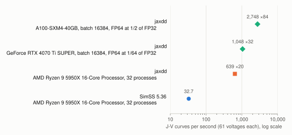

<h1 align="center"></h1>

A one-dimensional drift-diffusion solver for perovskite solar cells, written in JAX to solve
hundreds of thousands of devices at once on a data-centre GPU (A100/H100). It follows the device
model of [SIMsalabim](https://github.com/kostergroup/SIMsalabim) and is validated against its
output: anyone who sweeps SimSS over a parameter grid can run the same input files in batches.

It reads SIMsalabim's input files and solves one device or a batch of thousands: the J-V curves
of SimSS 5.36's steady state, with ions free or frozen after a pre-bias, and the transients of
ZimT 5.36, on CPU and GPU, differentiable in the input's parameters. Against SimSS 5.36 it agrees
to 1e-6 of the current scale with SimSS's own Bernoulli approximation; where the two differ by
more, it has so far been SimSS's error, documented in [`docs/differences.md`](docs/differences.md).
On one A100 about 2750 J-V curves per second, on two 5400 (a batch is split across every GPU
the process sees), on a 16-core desktop CPU about 640: 84×, 166× and 20× SimSS on all cores of
that desktop.

**How it works and how to use it:** the handbook in [`docs/`](docs/README.md) (overview,
tutorial, model, solver with flowcharts, batching, hardware, validation).
**What changed:** [`CHANGELOG.md`](CHANGELOG.md). **What is planned:** [`PLAN.md`](PLAN.md).

## Install

Python 3.11 or newer. The release, from GitHub:

```bash
pip install "jaxdd @ git+https://github.com/trn84/jaxdd@v0.2.0"            # CPU
pip install "jaxdd[cuda12] @ git+https://github.com/trn84/jaxdd@v0.2.0"    # an NVIDIA GPU
```

or the wheel attached to the [release](https://github.com/trn84/jaxdd/releases/tag/v0.2.0)
(`pip install jaxdd-0.2.0-py3-none-any.whl`, with `"jax[cuda12]"` on an NVIDIA GPU). jaxdd is
pure Python on JAX ≥ 0.4.31 and NumPy ≥ 1.26; the extra `fit` adds SciPy for `jaxdd.fit`.
With a CUDA jaxlib, JAX uses the GPU by default; `JAX_PLATFORMS=cpu` forces the CPU.

For the tests, the validation scripts and the benchmarks, from a clone:

```bash
git clone https://github.com/trn84/jaxdd.git && cd jaxdd
python -m venv .venv && .venv/bin/pip install -e ".[dev]"     # ".[dev,cuda12]" on an NVIDIA GPU
.venv/bin/python -m pytest -q                                   # against SimSS's and ZimT's curves
.venv/bin/python validation/bench.py 64 64                      # J-V curves per second
```

## Use

```python
import numpy as np
import jaxdd

setup = jaxdd.read_setup("tests/data/thin_l1_light/simulation_setup.txt")   # SIMsalabim's files
jaxdd.check_supported(setup)            # NotImplementedError naming anything jaxdd does not solve
V = np.linspace(-0.2, 1.3, 61)

res = jaxdd.solve_jv(jaxdd.build_device(setup), V)       # one device: res.J, res.converged

cases = ["thin_l1_light", "frozen_1e17_x1_thin_light", "steady_1e17_thin_light"]
devices = [jaxdd.build_device(jaxdd.read_setup(f"tests/data/{c}/simulation_setup.txt"))
           for c in cases]                               # many: one grid size NP for all
J, converged, iterations = jaxdd.solve_batch(jaxdd.prepare(devices), V)   # devices × voltages
```

The [tutorial](docs/tutorial.md) goes through it: the options, gradients and fits, transients,
building devices in code, comparing with SimSS.

## Speed

<!-- benchmark:begin -->
<picture>
  <source media="(prefers-color-scheme: dark)" srcset="benchmarks/speedup-dark.svg">
  
</picture>

The same devices for every solver (`benchmarks/run.py`: the three committed SimSS cases, traps, ions and doping drawn at random), each measured with the current code. jaxdd computes in FP64: a data-centre GPU runs it at half its FP32 rate, a consumer card at 1/64, which is why a gaming GPU is barely faster than a desktop CPU here. jaxdd's curves agree with SimSS's to 1.5e-05 of the current scale on 48 of the devices. How to get the most out of each: [`docs/hardware.md`](docs/hardware.md).

| Solver | Hardware | Curves per second | × SimSS |
|---|---|---|---|
| SimSS 5.36 | AMD Ryzen 9 5950X 16-Core Processor, 32 processes | 32.7 | 1 |
| jaxdd | AMD Ryzen 9 5950X 16-Core Processor, 32 processes | 639 | 20 |
| jaxdd | GeForce RTX 4070 Ti SUPER, batch 16384, FP64 at 1/64 of FP32 | 1,048 | 32 |
| jaxdd | A100-SXM4-40GB, batch 16384, FP64 at 1/2 of FP32 | 2,748 | 84 |
| jaxdd | 2× A100-SXM4-40GB, batch 16384 per GPU, FP64 at 1/2 of FP32 | 5,435 | 166 |
<!-- benchmark:end -->

**Measure a machine** (each part runs where the machine has it, the same devices for every
solver; `--help` lists the sizes):

```bash
.venv/bin/pip install -e ".[dev,bench]"                     # "jax[cuda12]" too on an NVIDIA GPU
.venv/bin/python benchmarks/run.py --label "A100 pod"                       # jaxdd: GPU and CPU
docker build -t jaxdd/simss:5.36 simss                                      # SimSS, see simss/
.venv/bin/python benchmarks/run.py --label "my server" --simss-docker jaxdd/simss:5.36
.venv/bin/python benchmarks/run.py --label "laptop" --simss simss --simss-fixed simss_fixed_ions
.venv/bin/python benchmarks/plot.py                                         # figure and table
```

SimSS needs the release's `simss` and, for the frozen-ion case, the patched `simss_fixed_ions`;
[`simss/`](simss/README.md) builds an image with both. On a CPU jaxdd runs one single-threaded
process per core, its fastest use of a CPU ([`docs/hardware.md`](docs/hardware.md)). Each run
writes `benchmarks/results/<label>.json`; commit it to add the machine.

## Licence

GNU LGPL version 3 ([`COPYING.LESSER`](COPYING.LESSER), supplementing the GNU GPL version 3 in
[`COPYING`](COPYING)), as SIMsalabim. What derives from SIMsalabim is listed in
[`NOTICE`](NOTICE).

## Citing

If you use jaxdd, cite SIMsalabim, whose model it implements:

> M. Koopmans, V. M. Le Corre, L. J. A. Koster, *SIMsalabim: An open-source drift-diffusion
> simulator for semiconductor devices*, J. Open Source Softw. 7, 3727 (2022),
> doi:[10.21105/joss.03727](https://doi.org/10.21105/joss.03727)
