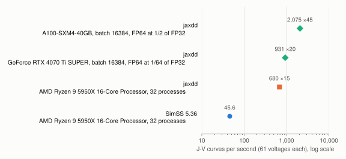

<h1 align="center"></h1>

A one-dimensional drift-diffusion solver for perovskite solar cells, written in JAX to solve
hundreds of thousands of devices at once on a data-centre GPU (A100/H100). It follows the device
model of [SIMsalabim](https://github.com/kostergroup/SIMsalabim) and is validated against its
output. First use: the drift-diffusion tables of
[FauxPV](https://git.bugraturan.de/trn84/fauxpv) (`tools/dd_tables.py`).

**Status: M1–M3 built, in use by FauxPV** (2026-11-08). One device and batched
(`jaxdd.batch.solve_batch`), with ions free or frozen after a pre-bias, on CPU and GPU. Against
SimSS 5.36 on FauxPV's tables every gap beyond 1e-3 has been SimSS's own (an early stop, or a
pre-bias it froze unconverged). On one A100 about 1200 J-V curves per second, 77× SimSS on a
64-core server; FauxPV's `tools/dd_tables.py --backend jaxdd` computes its 918 050-device ion
grid with it. Plan and milestones: [`PLAN.md`](PLAN.md).
Where jaxdd differs from SIMsalabim, and why: [`DIFFERENCES.md`](DIFFERENCES.md). Current state and next steps: [`NEXT.md`](NEXT.md).

## Try it

```bash
git clone https://github.com/trn84/jaxdd.git && cd jaxdd
python -m venv .venv && .venv/bin/pip install -e ".[dev]"     # add "jax[cuda12]" on an NVIDIA GPU
.venv/bin/python -m pytest -q                                   # against SimSS's own curves
.venv/bin/python validation/bench.py 64 64                      # J-V curves per second
```

## Speed

<!-- benchmark:begin -->
<picture>
  <source media="(prefers-color-scheme: dark)" srcset="benchmarks/speedup-dark.svg">
  
</picture>

The same devices for every solver (`benchmarks/run.py`: the three committed SimSS cases, traps, ions and doping drawn at random). Run it on a machine of yours and send the JSON in `benchmarks/results/`; `benchmarks/plot.py` redraws this. Factors over SimSS on Ryzen 9 5950X desktop (32 processes, 46.3 curves/s).

| Machine | Solver | Processes / batch | Curves per second | × reference SimSS | jaxdd against SimSS (max ΔJ / scale) |
|---|---|---|---|---|---|
| A100 80GB PCIe (RunPod) (NVIDIA A100 80GB PCIe · 128 logical cores) | jaxdd, GPU | batch 16384 | 1,160 | 25.1 |  |
| Ryzen 9 5950X desktop (NVIDIA GeForce RTX 4070 Ti SUPER · 32 logical cores) | SimSS 5.36, all cores | 32 processes | 46.3 | 1.0 | 1.5e-05 on 48 devices |
| Ryzen 9 5950X desktop (NVIDIA GeForce RTX 4070 Ti SUPER · 32 logical cores) | jaxdd, all CPU cores | 32 processes | 365 | 7.9 |  |
| Ryzen 9 5950X desktop (NVIDIA GeForce RTX 4070 Ti SUPER · 32 logical cores) | jaxdd, GPU | batch 16384 | 297 | 6.4 |  |
<!-- benchmark:end -->

**Measure a machine** (each part runs where the machine has it, the same devices for every
solver; `--help` lists the sizes):

```bash
.venv/bin/pip install -e ".[dev,bench]"                     # "jax[cuda12]" too on an NVIDIA GPU
.venv/bin/python benchmarks/run.py --label "A100 pod"                       # jaxdd: GPU and CPU
.venv/bin/python benchmarks/run.py --label "EPYC server" --simss-docker fauxpv/simss:5.36
.venv/bin/python benchmarks/run.py --label "laptop" --simss simss --simss-fixed simss_fixed_ions
.venv/bin/python benchmarks/plot.py                                         # figure and table
```

SimSS needs the release's `simss` and, for the frozen-ion case, FauxPV's patched
`simss_fixed_ions` (its `tools/simss/Dockerfile` builds an image with both). On a CPU jaxdd runs
one single-threaded process per core, its fastest use of a CPU (`NEXT.md`). Each run writes
`benchmarks/results/<label>.json`; commit it to add the machine.

## Licence

GNU LGPL version 3 ([`COPYING.LESSER`](COPYING.LESSER), supplementing the GNU GPL version 3 in
[`COPYING`](COPYING)), as SIMsalabim. What derives from SIMsalabim is listed in
[`NOTICE`](NOTICE).

## Citing

If you use jaxdd, cite SIMsalabim, whose model it implements:

> M. Koopmans, V. M. Le Corre, L. J. A. Koster, *SIMsalabim: An open-source drift-diffusion
> simulator for semiconductor devices*, J. Open Source Softw. 7, 3727 (2022),
> doi:[10.21105/joss.03727](https://doi.org/10.21105/joss.03727)
