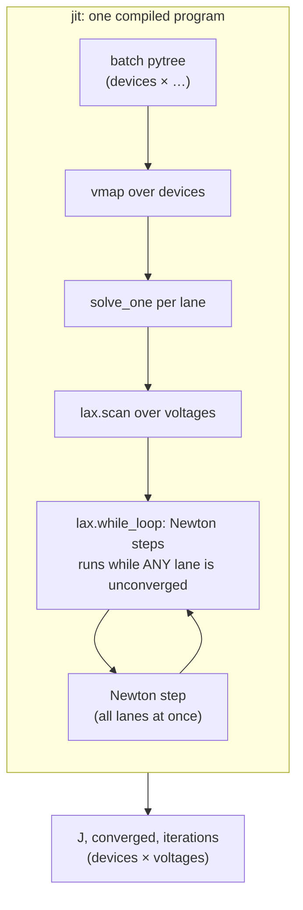

# Many devices at once

`jaxdd.batch` is the solver of [solver.md](solver.md) written as one pure function of one
device, vectorised over a batch with `jax.vmap` and compiled with `jax.jit`.

## A device as a pytree

`prepare(devices)` turns each `Device` into a dictionary of arrays (stencil coefficients, ion
masks and totals, grid, boundary values, recombination and generation, pre-bias settings as
numbers) and stacks every leaf along a new first axis: one pytree of `batch × …` arrays. All may
differ between lanes but the shapes: `NP` is the same for all. A key only some devices need
(interface traps, finite surface recombination, a free end, …) is zeros for the others.

## One function, vectorised

```text
solve_batch(batch, voltages) = jit( vmap( solve_one, over the batch axis ) )(batch, voltages)
```

| In the one-device solver (`solve_jv`) | In the batched solver (`batch._solve_one`) |
|---|---|
| Python `for` over the voltages | `lax.scan` over the voltages |
| Python `while` over the Newton steps | `lax.while_loop`, the convergence test in its condition |
| `if dev.pre_cond:` pre-bias, `if dev.fix_ions:` freeze | always solve at the first voltage (`V_pre` or `V[0]`, by `jnp.where`); freeze by a mask |
| the voltages in order, from the pre-bias | outwards from `V_pre`: one `lax.scan` over the voltages permuted per device (up, then down), the carry reset to the pre-bias at the turn |
| current in NumPy after each voltage | current in JAX inside the loop (also a convergence criterion) |
| `RuntimeError` if the pre-bias fails | the pre-bias's flag folded into every voltage's `converged` |

No branch depends on a device's data, so one compiled program serves every device, with or
without ions or pre-bias.



## The lockstep: a batch costs its slowest device

Under `vmap` a `lax.while_loop` with a per-lane condition runs **until the last lane has
converged**; finished lanes keep their values but their arithmetic is still done. At every
voltage the batch pays the maximum number of Newton steps over its devices, not the mean:

```python
needed = iterations.mean(axis=0).sum()      # what the devices needed
paid   = iterations.max(axis=0).sum()       # what the batch paid
```

On the benchmark devices (`validation/bench.py`) 2.8 steps per voltage are needed and 3.9 paid.
On 16 384 devices of a grid with ions (250 nm absorber, every diffusion length, ion density and
distribution; light and dark) 2.8 are needed; the largest over the batch is 4 at most voltages
and up to 12 above 0.7 V, so one pass pays 6.8 at batch 16 384 and 5.6 at 4096. What keeps it
there is the scan outwards from the pre-bias and the Jacobian assembled by intervals
([solver.md](solver.md)): without them one pass paid 21.8. In two passes (limit 6) the batch pays
4.59, none unconverged, and takes 9.0 s on an A100-SXM4-40GB (1816 curves/s; 9.2 with the Mosaic
sweep) and 24.5 s on an RTX 4070 Ti SUPER after compilation (`validation/chunk.py`; the first
call 13 and 7 s more). A program that builds its devices on the CPU must build about 1800 a
second to keep an A100 busy.

What helps, cheapest first:

1. **Sort devices into batches of similar difficulty.** Diffusion length, ion density and doping
   are known before solving; the hard devices then hold up only each other.
2. **Two passes**, which `solve_batch` does itself: every device with at most `first_max_iter`
   (6) Newton steps per voltage, then the devices with a voltage that missed it, together, with
   `max_iter` (60), padded to a power of two (repeating the last) so that few shapes compile. A
   device solved in the first pass gets exactly the one-pass result; a re-solved one its second
   pass, `iterations` included. Where no device misses the limit there is no second pass.
   `first_max_iter=None` solves in one pass, as does a call inside `jax.jit`, `jax.jvp` or
   `jax.vmap` (the second pass's shape is known only after the first).

   In one pass the batch pays a slow device's steps at its voltages, in two at most the limit;
   the second pass solves a few dozen devices, a small batch that keeps a GPU barely busy. On
   `validation/hard.py` at batch 16 384 (one pass pays 6.4 steps per voltage) two passes are
   faster: 1547 against 1426 curves/s on an A100-SXM4-40GB, 601 against 553 on an RTX 4070 Ti
   SUPER. They are slower at batch 4096 on the RTX 4070 Ti SUPER (536 against 589) and with the
   scan as the sweep (A100, 16 384: 1007 against 1049). Each new power of two of stragglers
   compiles once more. The limit is 6 because an ordinary device takes 2–4 steps, sometimes 5.
3. **Smaller batches.** The expected maximum over fewer lanes is lower; on an A100 batch 4096
   runs at about three quarters of the rate of 16384 where the steps paid are the same (2145
   against 2748 curves/s on the benchmark devices).

A lane that reaches `max_iter` is flagged in `converged`, whichever pass it was in.

## Compilation

The program depends on the shapes (batch size, `NP`, number of voltages) and on `max_iter`,
`first_max_iter`, `bernoulli_name` and `strict`; the second pass compiles once per power of two
of stragglers. A new combination compiles again: seconds on a CPU at small batches, 20 s on an
A100 and about 60 s on a consumer GPU at batch 16384. A sweep should use one batch size, padding
the last batch.

## Memory

A device takes a few hundred kB during a solve (some 30 arrays over the grid, the 3×3 blocks of
its Jacobian, the sweep's blocks). Batch 16384 fits on an 80 GB A100 and on a 16 GB card; above a
few thousand devices the rate grows only slowly ([hardware.md](hardware.md)).
