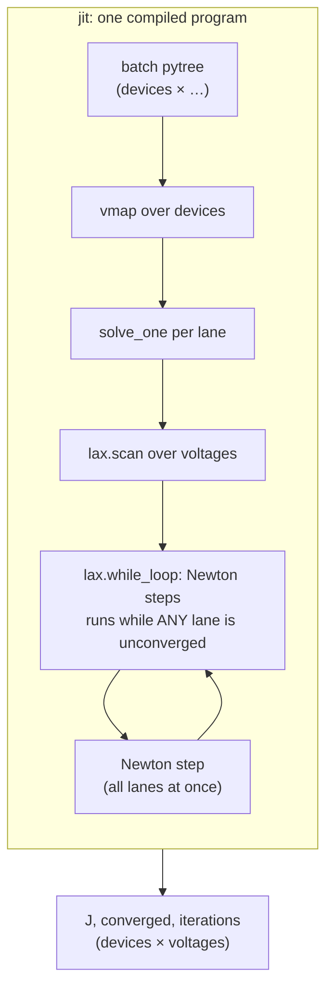

# Many devices at once

`jaxdd.batch` is the solver of [solver.md](solver.md) written as one pure function of one
device, then vectorised over a batch with `jax.vmap` and compiled with `jax.jit`. This page
explains how that works, and what it means for the time a batch takes.

## A device as a pytree

`prepare(devices)` turns each `Device` into a dictionary of arrays: the stencil coefficients of
every interior point, the ion masks and totals, the grid, the boundary values, the recombination
and generation arrays, the pre-bias settings as numbers. Then it stacks every leaf of every
device along a new first axis. The result is one pytree whose leaves are `batch × …` arrays.
Everything about a device may differ between lanes except the shapes: the number of grid points
`NP` is the same for all.

## One function, vectorised

```text
solve_batch(batch, voltages) = jit( vmap( solve_one, over the batch axis ) )(batch, voltages)
```

`solve_one` is the sequence of [solver.md](solver.md), written so that `vmap` can vectorise it:

| In the one-device solver (`solve_jv`) | In the batched solver (`batch._solve_one`) |
|---|---|
| Python `for` over the voltages | `lax.scan` over the voltages |
| Python `while` over the Newton steps | `lax.while_loop`, the convergence test in its condition |
| `if dev.pre_cond:` pre-bias, `if dev.fix_ions:` freeze | always solve at the first voltage (`V_pre` or `V[0]`, chosen by `jnp.where`); freeze by a mask: `jnp.where(flag, frozen, free)` |
| the voltages in order, from the pre-bias | outwards from `V_pre`: one `lax.scan` over the voltages permuted per device (up, then down), the carry reset to the pre-bias at the turn by `jnp.where` |
| current in NumPy after each voltage | current in JAX inside the loop (it is also a convergence criterion) |
| `RuntimeError` if the pre-bias fails | the pre-bias's flag folded into every voltage's `converged` |

No branch depends on a device's data, so one compiled program serves every device, with or
without ions, with or without a pre-bias.



## The lockstep: a batch costs its slowest device

Under `vmap`, a `lax.while_loop` with a per-lane condition becomes one loop that runs **until
the last lane has converged**. Lanes that are done keep their values (each step's result is
selected away), but their arithmetic is still done. At every voltage the batch therefore pays
the maximum number of Newton steps over its devices, not the average. `solve_batch` returns the
steps each device needed (`iterations`); compare their mean with their per-voltage maximum:

```python
needed = iterations.mean(axis=0).sum()      # what the devices needed
paid   = iterations.max(axis=0).sum()       # what the batch paid
```

On the benchmark devices (`validation/bench.py`) the ratio is about 1.4: 2.8 steps needed per
voltage, 3.9 paid (2.77 and 3.95 on 2048 of them; unchanged by the clipped start of each
voltage, [solver.md](solver.md), which is never active there). On a real parameter grid it can
be larger. On 16 384 devices of a grid with ions (250 nm absorber, every diffusion length, ion
density and ion distribution; light and dark) the devices need 2.8 steps per voltage; the
largest over the batch is 4 at most voltages and up to 12 above 0.7 V, so one pass pays about
6.8 at batch 16 384 and 5.6 at 4096. Two things took that from 21.8: the scan outwards from
the pre-bias (the first voltage had cost up to 28, [solver.md](solver.md)) and the Jacobian
assembled by intervals (devices with strong frozen charge had taken up to 60).

What helps, cheapest first:

1. **Sort devices into batches of similar difficulty.** Diffusion length, ion density and
   doping are known before solving; the hard devices (short diffusion length, many ions) then
   hold up only each other.
2. **Two passes**, which `solve_batch` does itself: every device with at most `first_max_iter`
   (6) Newton steps per voltage, then the devices with a voltage that missed it again,
   together, with `max_iter` (60). The stragglers are padded to a power of two (repeating the
   last), so few shapes compile. A device solved in the first pass gets exactly the one-pass
   result (Poisson and Newton at the pre-bias are capped by `max_iter` in both passes); a
   re-solved one gets its second pass, `iterations` included. `first_max_iter=None` solves in
   one pass.

   Two passes are insurance against the device that does not converge: in one pass it makes
   the whole batch pay `max_iter` at its voltages, in two it costs the batch `first_max_iter`.
   Where no device fails, one pass is a little faster. On the 16 384 devices above (batch 4096,
   an RTX 4070 Ti SUPER) one pass took 35 s, two passes with limit 6 38 s and with 8 43 s; with
   the residual still assembled row by row, where some devices failed, one pass took 143 s and
   two passes with limit 6 89 s. An ordinary device takes 2–4 steps at every voltage, sometimes
   5: 6 keeps a step's margin.
3. **Smaller batches.** The expected maximum over fewer lanes is lower. On an A100, batch 4096
   runs at about 88 % of the rate of 16384.

The `converged` flag is unaffected: a lane that reaches `max_iter` is flagged, whichever pass it
was in.

## Compilation

The compiled program depends on the shapes (batch size, `NP`, number of voltages) and on the
options `max_iter`, `first_max_iter`, `bernoulli_name` and `strict`; the second pass compiles
once for each power of two of stragglers. Each new combination compiles again: a few
seconds on a CPU at small batches, 20 s on an A100 and about 60 s on a consumer GPU at batch
16384. A sweep should use one batch size throughout, padding the last batch.

## Memory

A device takes a few hundred kB during a solve (some 30 arrays over the grid, the 3×3 blocks of
its Jacobian, the sweep's intermediate blocks). Batch 16384 fits easily on an 80 GB A100 and on
a 16 GB card. Try the batch size on the card at hand; above a few thousand devices the rate
grows only slowly ([hardware.md](hardware.md)).
