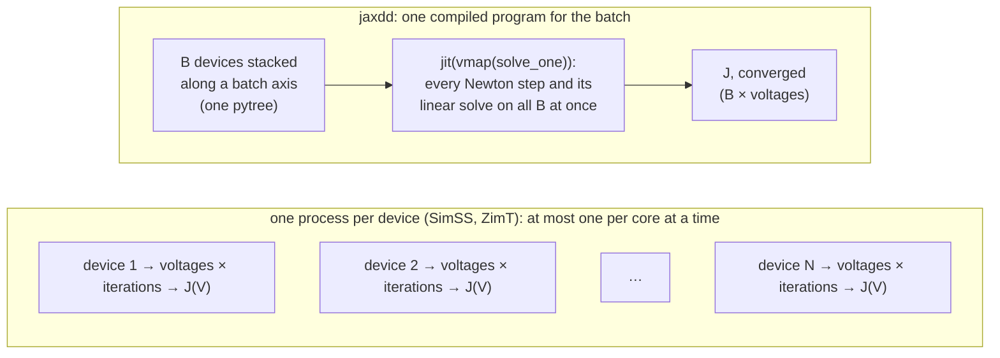

# What jaxdd is, and why it is built this way

jaxdd is a one-dimensional drift-diffusion solver for semiconductor devices, perovskite solar
cells first. It solves the same discrete equations as
[SIMsalabim](https://github.com/kostergroup/SIMsalabim) 5.36 (its steady-state program SimSS and
its transient program ZimT), reads SIMsalabim's input files and is validated against their
output. What it adds is scale: written in JAX, it solves thousands to hundreds of thousands of
devices at once, on a GPU or on every core of a CPU.

## The problem it solves

One device is small: about 400 grid points, three unknowns each, a Newton step of a few hundred
kFLOP; SimSS solves it in a fraction of a second to a few seconds. What costs time is the
*sweep*: a table of J-V curves over a parameter grid is hundreds of thousands to millions of
devices, each another SimSS process. On a 16-core desktop SimSS manages about 33 curves per
second (the README's benchmark): a million take eight and a half hours, and every further axis
multiplies that.

The devices of a sweep are independent. Stacked along a batch axis, 10⁴–10⁵ of them are one
large computation, a block-tridiagonal Newton system per device, sequential along the grid and
parallel across the batch: the shape a GPU (and a CPU with many cores) handles well. jaxdd writes
the solver once for one device as a pure JAX function, and `jax.vmap` makes it the batched one.

No branch depends on a device's data, so every device runs the same instructions, on a CPU, one
GPU or several ([batching.md](batching.md)).

**FP64 throughout.** Carrier densities span some 20 orders of magnitude and the
Scharfetter–Gummel fluxes subtract nearly equal exponentials, so jaxdd runs with
`jax_enable_x64`. That decides the hardware: data-centre GPUs (A100, H100, MI50) do FP64 at half
their FP32 rate, consumer GPUs at 1/64, where a CPU is as fast ([hardware.md](hardware.md)).

## Words used throughout

| Word | Meaning |
|---|---|
| device | one solar cell: its layers, parameters and generation profile, as one SIMsalabim input |
| run, curve | one J-V curve of one device: the steady state at every voltage of a list (61 voltages, −0.2 to 1.3 V, in the benchmarks) |
| batch | devices solved together in one compiled program; they share the grid size `NP` and the voltages |
| lane | one device's slot in a batch |
| pre-bias | SimSS's `preCond`: the device is first settled at `Vpre` with its ions free |
| frozen ions | SimSS's `fixIons` after a pre-bias: the ion profile of the pre-bias held fixed for the scan; without a pre-bias, the ions held at SimSS's starting density |
| current scale | the generation current `q·∫G dx` (at least 1 A/m²): accuracy is stated relative to it |
| `η` | collection efficiency `(J_dark − J_light)/J_gen`, a normalised measure in which curves of different devices are compared |

## Scope

The physics is SimSS 5.36's steady state of a solar cell with mobile ions, in full, and ZimT's
transients, each part validated against SimSS or ZimT on its own devices
([validation.md](validation.md)); any number of layers, each with its own parameters. Marked
"jaxdd's": what SIMsalabim does not have.

| Part | Supported |
|---|---|
| Layers | any number; per layer thickness, permittivity, band edges, effective density of states, mobilities (constant or field-dependent, `mobnDep`, `mobpDep`), donor and acceptor doping |
| Grid | `NP` points: jaxdd's graded grid by default, geometric towards every layer's ends, its points per layer by need; or SIMsalabim's (`grid="simss"`), exponentially graded in each layer (`grad`), for a comparison with SimSS point by point ([model.md](model.md#the-grid)) |
| Interfaces | band offsets; thermionic transfer at a finite velocity (`nu_int_n`, `nu_int_p`); interface traps, one level per interface or several from a trap file (`intTrapFile`), neutral or charged (`N_t_int`, `E_t_int`, `intTrapType`) |
| Free surfaces | jaxdd's: either end or both without an electrode (`W_L`, `W_R` = `free`), its surface recombining by SRH; the quasi-Fermi level splitting, implied `V_oc` and PLQY of a steady state (`solve_state`, a batch's `solve_states`, differentiable), with mobile ions and the rates in the field, and in time (`solve_transient`: a photoluminescence decay) ([model.md](model.md#free-surfaces-jaxdds-w_l-or-w_r--free)) |
| Contacts | at the work functions `W_L`, `W_R` (or `sfb`), anywhere in the gap (a Schottky barrier away from the band edges); infinite or finite surface recombination (`S_n_L`, `S_p_L`, `S_n_R`, `S_p_R`); the left electrode the cathode or the anode (`leftElec = -1` or `1`); series and shunt resistance as SimSS's external circuit |
| Recombination | direct (`k_direct`, or Langevin's from the mobilities, `useLangevin`); bulk SRH through one trap level per layer or several from a trap file (`bulkTrapFile`), neutral or charged (`bulkTrapType`); jaxdd's: each level of a trap file with its own capture coefficients (columns `C_n C_p`, [model.md](model.md#bulk-traps-init_trapping-calc_trap_filling_charge)); jaxdd's: photon recycling in time, the radiative recombination's photons reabsorbed by a slab's optics (`jaxdd.recycling`, `solve_transient(recycle=...)`); jaxdd's: Auger recombination (`C_n_Auger`, `C_p_Auger`, off by default, [model.md](model.md#auger-recombination-jaxdds-off-by-default)) |
| Generation | a profile from a file, uniform per layer (`genProfile = none`), or by the transfer-matrix method from n,k data and a spectrum (`calc`); scaled by `G_frac`; field-dependent by Braun's dissociation (`fieldDepG`, all five distance distributions) |
| Ions | anions and cations, mobile in regions of one layer or several adjacent ones (`ionsMayEnter`), any number per species: free at every voltage, or settled at a pre-bias and frozen (`preCond`, `fixIons`, as SimSS with [`simss/fixed_ions.patch`](../simss/README.md)), or held from the start (`fixIons` alone); immobile ions as fixed charge; bounded by their sites (`N_max_anion`, `N_max_cation`: jaxdd's, off by default, [model.md](model.md#ions-bounded-by-their-sites-jaxdds-off-by-default)), in the steady state and in time (`ion_flux="modified-drift"` the other scheme) |
| Statistics | the carriers': Boltzmann's (SIMsalabim's, the default), Blakemore's or Fermi–Dirac's `F_{1/2}` (`build_device(..., statistics=)`, jaxdd's, [model.md](model.md#the-carriers-statistics-jaxdds-boltzmanns-by-default)) |
| Voltages | the caller's; SimSS's own from the setup by `simss_voltages` (uniform or logarithmic towards `Vacc`, `Vdist = 1` or `2`; up or down, `Vscan`; or `expJV`'s, `useExpData`); ZimT's time steps by `read_tvg` |
| Current | SIMsalabim's integral form (`currDiffInt = 2`) or its differential form (`currDiffInt = 1`), averaged over the device; in time the integral form's sums over each point's control volume, ZimT's own a switch ([differences.md](differences.md) §13) |
| Output | `J(V)` and a `converged` flag per device and voltage; the number of Newton steps |
| Transients | ZimT's time steps for electrons, holes, traps (bulk and interface, neutral or charged, one level or several) and mobile ions (in regions of one layer or several, 5×5 blocks), the voltage given, at the open circuit (`Vext = oc`) or behind a series resistance, the internal voltage then an unknown of each step's Newton solve (`jaxdd.transient.solve_transient`, implicit Euler, the traps' occupations solved exactly over each step, the displacement current, either form of the current, batched with steps of their own per device); ZimT's automatic stop (`Track`) and `failureMode`; every column of its `tJFile` (`tj_columns`, `specialOutput = spv` too); each step's profiles (`profiles=True`, the ions and the traps' occupations too) in place of its `varFile`; jaxdd's: a transient that goes on from a step's state (`initial=`, `TransientResult.final`, `.state(k)`, [model.md](model.md#going-on-from-a-state-jaxdds)); differentiable in the parameters, step by step in forward mode |
| Impedance | jaxdd's: in the frequency domain at a steady state, one linear solve per frequency (`solve_impedance`), with mobile ions, bulk and interface traps, a series resistance and a shunt ([model.md](model.md#impedance-jaxdds-solve_impedance)) |

Everything else is **refused by name**, never approximated: `check_supported` raises
`NotImplementedError` listing each parameter outside this scope (two of SimSS's ionic regions it
solves against the input, [differences.md](differences.md) §10). What may come is in
[PLAN.md](../PLAN.md).

## Where jaxdd follows SIMsalabim, and where it does not

jaxdd solves SIMsalabim's **discrete equations**: the same Scharfetter–Gummel discretisation in
the generalised potentials, interfaces, integral current and physical constants. On SIMsalabim's
grid (`grid="simss"`) a converged jaxdd solution is SimSS's solution, comparable to round-off.
jaxdd's own grid, the default, is graded towards every layer's ends and converges with fewer
points; on it the curves differ from SimSS's by SimSS's grid error
([model.md](model.md#the-grid), [differences.md](differences.md) §12).

It solves them **differently**: SimSS iterates Poisson's equation and the continuity equations in
turn (Gummel), one device at a time; jaxdd takes a coupled Newton step on all unknowns of all
devices at once ([solver.md](solver.md)). Where SimSS's answer is not the solution of its own
equations (it stops early, it freezes an unconverged pre-bias) or uses an approximation jaxdd can
avoid (its Bernoulli series), jaxdd takes the correct answer by default, with a switch that
reproduces SimSS's number ([differences.md](differences.md)).

## Design decisions

| Question | Choice | Why |
|---|---|---|
| Language | JAX (Python) | batching by `vmap`, the Jacobian by automatic differentiation, CPU and GPU from one code, gradients of the curves (by implicit differentiation); Python, where most sweeps and fits are written |
| Unknowns | `(V, ln n, ln p)` per grid point | densities never go negative, the 20 orders of magnitude live in the logarithm; Scharfetter–Gummel stays in `n`, `p` |
| Nonlinear solver | coupled Newton | few steps per voltage, robust at high injection; a Gummel scheme needs many more iterations and does not batch better |
| Jacobian | by intervals: each Scharfetter–Gummel flux and its derivatives once (`B'` by `jax.jvp`), each point's 3×3 blocks from its two intervals; tested against `jax.jacfwd` of one point's residual | 4× faster than autodiff of each point, and no round-off floor where frozen ions leave a carrier-free bulk; never the dense Jacobian of the whole device |
| Linear solver | block Thomas sweep: a `lax.scan`, and for a batch on an NVIDIA GPU one Pallas kernel | the system is block tridiagonal; the kernel saves the scan's ~1450 kernel launches per sweep; parallel cyclic reduction is slower on every machine and batch size |
| Input | SIMsalabim's parameter files | every SimSS user's sweep runs unchanged; a Python API of pytrees beside it |
| Scope | general structure, SIMsalabim's physics and more | anyone who sweeps SimSS can use it; each part validated against SimSS or ZimT |
| First GPU | NVIDIA A100 (CUDA) | JAX works there as is; the code stays plain JAX, so other platforms have nothing to undo |
| Licence | LGPL-3.0, like SIMsalabim | SIMsalabim's code may be carried over where it helps; programs under other licences may call jaxdd |

## What the speed is for

None of these is planned work. Each says how much speed it needs.

| | Curves/s | Per hour | 1024 curves |
|---|---|---|---|
| A100 (40 GB SXM4, batch 16 384) | ~2750 | 10 M | 0.37 s |
| a 16-core desktop CPU | ~640 | 2.3 M | 1.6 s |
| one CPU core | ~58 | 210 k | 18 s |
| a neural surrogate, evaluated | ~10⁶ | — | ~1 ms |

1. **A surrogate trained on data simulated during training.** Simulator and network are both
   JAX and can share one GPU, no dataset stored. Simulation takes about 100× a training step; a
   replay buffer (each curve serves several steps) makes that work. It pays most with active
   learning, simulating where the surrogate is still wrong in spaces too large for a grid; it
   steers towards the hard devices, which the lockstep makes slow. Training must mask by the
   `converged` flag. For a fixed dataset: 10 M curves in about 1 h on one A100.
2. **Parameters from measurements, with uncertainty.** MCMC needs 10⁵–10⁶ simulations per cell,
   0.6–6 min on one A100. Ensemble samplers and sequential Monte Carlo map onto the batch;
   gradient-based samplers and optimisers use the curves' gradients ([solver.md](solver.md)).
3. **Sensitivity analysis and uncertainty propagation.** Sobol indices by Saltelli sampling
   (N·(d+2) simulations: 1.8·10⁵ for N = 10⁴, d = 16, about a minute) and Monte Carlo over process
   spread are independent devices, which is exactly what the batch does.
4. **Inverse design.** A stack optimised by gradient from many starts in parallel; thicknesses
   need the computed optics, with a profile from a file only the electrical parameters.
5. **Drift-diffusion inside a larger simulation.** One solve per simulated measurement, for
   example in a digital twin of a laboratory that ages and measures many cells; mostly
   transients, which cost 10–100× a steady-state curve. This is the one use that would need a
   faster solver ([hardware.md](hardware.md#why-there-is-no-fused-kernel)).
6. **Interactive tools.** A slider and its curve: about 50 ms per curve on one CPU core is
   enough; the GPU pays when each update needs many curves (a fit, an uncertainty band).
7. **Two dimensions (a project of its own).** Grain boundaries, pinholes, patterned contacts,
   edges; Monte Carlo over grain structures condensed into effective 1D parameters. About 10⁵
   unknowns per device instead of 1200, so the parallelism moves into the device and batches
   shrink to tens. The sparse banded Newton system wants a sweep over grid columns with dense
   (3·n_y)² blocks (batched LU on FP64 tensor cores, n_y up to 100–200) or matrix-free
   Newton–Krylov (JVPs, GMRES; JAX has no algebraic multigrid or sparse direct solver on the GPU
   for its preconditioner). The physics and the Jacobian carry over; the linear solver, batching,
   mesh and reference do not (SIMsalabim is 1D: Sentaurus, ATLAS, COMSOL or ChargeTransport.jl).

**The counter-argument.** The faster the simulator, the less a surrogate is needed: fits and
sensitivity analyses can call jaxdd directly, with the exact physics. A surrogate pays where
microseconds per evaluation are needed.

## The repository

| Path | What |
|---|---|
| `src/jaxdd/__init__.py` | the API at the top level (`jaxdd.read_setup`, `jaxdd.solve_batch`, …) and `jaxdd.__version__` |
| `src/jaxdd/simss_input.py` | reading SIMsalabim's input files, from a directory (`read_setup`) or from texts (`setup_from_texts`); `check_supported` |
| `src/jaxdd/device.py` | the grid (jaxdd's graded one or SIMsalabim's) and every static array of one device: its structure and parameters (`device_parameters`), the arrays from them in NumPy (`build_device`) or JAX (`device_arrays`) |
| `src/jaxdd/solver.py` | the discrete equations, the Newton step, the block sweep; `solve_jv` for one device |
| `src/jaxdd/batch.py` | the same solver as one pure function, `vmap`ped: `prepare`, `solve_batch` |
| `src/jaxdd/transient.py` | ZimT's transients of a batch: `solve_transient`, `tj_columns`; a step's state, `TransientState` |
| `src/jaxdd/optics.py` | the generation profile by the transfer-matrix method (`genProfile = calc`) |
| `src/jaxdd/sweep.py` | the batch's block sweep in one GPU kernel (Pallas), and the switch between it and the scan |
| `src/jaxdd/fit.py` | least squares from many starts at once: scipy's `least_squares` from each, their curves and Jacobians solved as one batch (`least_squares_many`) |
| `src/jaxdd/axes.py` | tables over parameters whose axes are refined by the interpolation's error: `refine_axes`, `tabulate`, `interpolate`, `in_chunks` |
| `src/jaxdd/sparse.py` | a spatially adaptive sparse grid over parameters, no tensor product: `refine_sparse`, `interpolate_sparse` |
| `src/jaxdd/impedance.py` | the impedance in the frequency domain at a steady state, one linear solve per frequency: `solve_impedance` |
| `src/jaxdd/statistics.py` | the carriers' statistics: Boltzmann's, Blakemore's, Fermi–Dirac's `F_{1/2}`, their inverses and excess chemical potentials |
| `src/jaxdd/recycling.py` | photon recycling: where each point's radiative recombination is absorbed again (`device_kernel`) |
| `src/jaxdd/constants.py` | SIMsalabim's physical constants |
| `tests/` | pytest suite, in parallel (pytest-xdist); `tests/data/` SimSS and ZimT runs (inputs and their `JV.dat`, `tj.dat`) as reference |
| `validation/` | scripts that compare with SimSS and time the solver ([validation.md](validation.md)) |
| `benchmarks/` | jaxdd against SimSS per machine, the README's figure ([hardware.md](hardware.md)) |
| `rocm/` | running on AMD MI50 (gfx906) cards ([hardware.md](hardware.md)) |
| `simss/` | building SimSS, the reference, with the patch for frozen ions ([README](../simss/README.md)) |
| `PLAN.md` | what is planned and what may come |
| `CHANGELOG.md` | what changed from one release to the next |
| `.github/workflows/ci.yml` | lint, the tests on the newest and the oldest supported JAX, the wheel; a release on a tag |
| `NOTICE`, `COPYING*` | licence and attribution |

## Licence and attribution

jaxdd is under the LGPL-3.0, as SIMsalabim. [`NOTICE`](../NOTICE) names SIMsalabim and lists
what derives from its code; it is kept current with every such change:

- A file whose code is translated or carried over from SIMsalabim keeps SIMsalabim's
  copyright notice in its header, says that it was translated and changed, names the
  SIMsalabim unit and version it follows and the date, and is listed in `NOTICE`
  (GPL-3.0 §5 a).
- A module that follows SIMsalabim's equations or routines names them in its docstring, as
  `device.py` and `solver.py` do; where it carries over code, the rule above applies too.
- A change to SIMsalabim itself (the patch in `simss/`) is listed in `NOTICE` with the file,
  the version and the date.

Every published result obtained with jaxdd cites SIMsalabim, as the README's
[Citing](../README.md#citing) asks.
