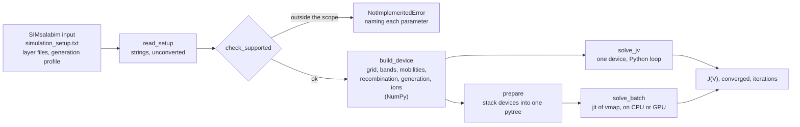
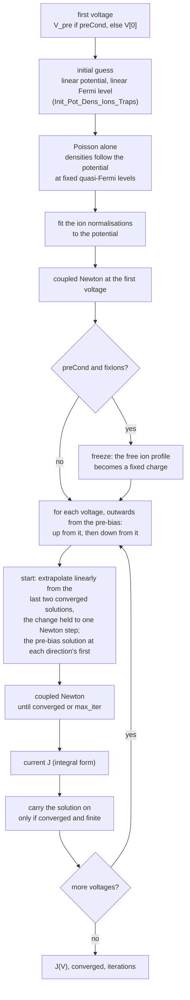
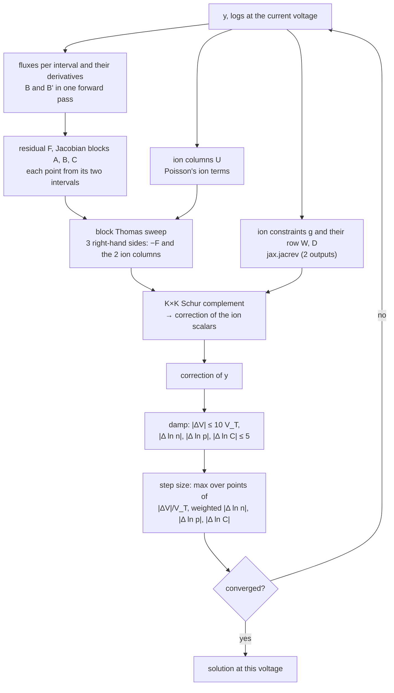

# How a J-V curve is solved

This page follows one device from its input files to its J-V curve: the data flow, the sequence
of solves, the Newton step and the linear solver. The batched solver ([batching.md](batching.md))
runs exactly this, for every device of a batch at once.

## From files to curves



Everything up to `build_device` is plain NumPy and happens once per device. From there on the
device is a set of static arrays (the stencil coefficients of [model.md](model.md), its
recombination and generation, its ions), and the solver only reads them.

## The unknowns

At each interior grid point `i = 1 … NP`, three unknowns:

```
y[i] = ( V[i], ln n[i], ln p[i] )
```

plus one scalar per mobile region of each ion species, the logarithm `ln C` of its Boltzmann
normalisation ([model.md](model.md)): with one region each, `ln C_a` and `ln C_c`. A species
that is not free (none, immobile, or frozen) keeps its scalar fixed by an identity row, and so
does a slot a batch pads with (`solver._slots`: the anions' regions first, then the cations',
at least one each; a batch takes the most of any of its devices).

The logarithms keep the densities positive and put their 20 orders of magnitude into a range
where a Newton step is well scaled. The boundary values (`V`, `ln n`, `ln p` at both contacts)
are fixed by the work functions and the applied voltage.

## The sequence of solves for one device



As pseudocode (`batch._solve_one`, the one-device form of the batched solver; `solve_batch`
sorts the voltages and returns the results in the caller's order):

```text
function solve_one(device, voltages):                   # voltages ascending
    V_first  ← device.V_pre if device.pre_cond else voltages[0]
    y        ← initial_guess(device, V_first)          # linear V, linear Fermi level
    y        ← poisson_only(y, V_first)                 # Newton on V alone, n and p follow V
    logs     ← fit_ion_normalisations(y)                # each free species to its number
    y, logs, pre_ok ← newton(y, logs, V_first)
    if device.pre_cond and device.fix_ions:
        freeze_ions(y, logs)                            # profile → fixed charge, scalars held

    up   ← [V in voltages if V ≥ V_first]               # ascending
    down ← [V in voltages if V < V_first], descending
    for V in up + down:                                 # one lax.scan, permuted per device
        if V is down[0]:                                # turn: back to the pre-bias
            y_last, y_before, V_last, V_before ← y, y, V_first, V_first
        r     ← (V − V_last)/(V_last − V_before) if V_last ≠ V_before else 0
        guess ← y_last + clip(r · (y_last − y_before), ±caps)   # the ion scalars alike
        y_new, logs_new, ok, steps ← newton(guess, logs, V)
        J[V]         ← terminal_current(y_new, V)
        converged[V] ← ok and pre_ok
        if ok and y_new, logs_new finite:               # jnp.where, per lane
            y_before, y_last ← y_last, y_new
            V_before, V_last ← V_last, V
            logs ← logs_new
    return J, converged, steps
```

**Why a Poisson-only start.** The linear initial guess is far from the solution in a device with
doped layers or ions. A few Newton steps on Poisson's equation alone, with `n ∝ exp(V/V_T)` and
`p ∝ exp(−V/V_T)` following the potential (SimSS's `Solve_Poisson` does the same), bring the
potential close before the coupled system starts; it is a scalar tridiagonal solve per step.

**Why charged bulk traps start neutral.** With charged bulk traps of a density close to the free
carriers' (3.9e21 m⁻³ at mid-gap in a 500 nm absorber), coupled Newton from that start does not
converge: every density step moves the traps' occupancy and so the potential, and every step
ends at its cap, for 200 steps. From the solution with the traps' charge left out (the same
device, their recombination kept) it converges in 5–6. So a device with charged bulk traps is
first solved at the first voltage with them neutral, and that solution is the start of the
coupled solve with their charge (`solve_jv` and the batch; the gradients do not see it, a start
has none). Devices without charged bulk traps skip it, to the bit.

**Why ions bounded by their sites start from Boltzmann's.** On the way from Poisson's start to
the solution, Newton passes states that would pile the ions far beyond their sites. Boltzmann's
ions pass through them; bounded ones (docs/model.md) saturate there, their density no longer
answers the potential, and Newton can cycle with every step at its cap: on 1024 devices of
`validation/hard.py`, 2 to 29 of them (sites of 1.21e28 to 1e26 m⁻³) did not converge at the
pre-bias, where Boltzmann's ions reach a thousandth of the sites. So a device with sites is
first solved at its first voltage with Boltzmann's ions, then with the bounded ones from there.
Where the bound changes the solution much (ions piled by Boltzmann's 50–80 times beyond their
sites, at a few times their mean density in sites) that second solve may not converge; it is
then solved again from Poisson's solution with the bounded ions, which is closer. The bounded
solve starts from Boltzmann's solution, or its last iterate where that did not converge, and a
bounded solution that converges either way is the start. Devices without sites skip all of it,
to the bit. The normalisations of a start (`_ion_logs`) are the bounded ions' too, by a few
Newton steps on their number from Boltzmann's closed form. `solve_states`, `solve_batch` and
`solve_transient`'s steady state at its first step take the same start (`batch._start`; the
single-device solver its own, `_scan`, the same steps).

**Many ions.** Where the mobile ions far outnumber the doping (ChargeTransport.jl's Ex103 cell,
1.6e25 m⁻³ of vacancies against 1e24 of doping, `tests/test_chargetransport.py`), Newton from
Poisson's start does not converge even in equilibrium, with Boltzmann's ions or bounded ones:
the ions' normalisation steps by its cap, +5 and −5 in turn, and the potential by its 10 `V_T`
at every step, a cycle (a step in `ln C` multiplies the ions' charge, which the potential
overshoots). With a sixty-fourth of them it converges, and from there with four times as many,
and so on (`ION_DENSITY_STAGES`: 1/64, 1/16, 1/4, 1 of every ion's density, mobile and fixed
alike, so that each layer stays neutral; each stage from the last, its normalisations raised
with the number): Ex103's cell in 21, 22, 7 and 4 steps, then 3 to its sites. A device takes
the stages only where Boltzmann's ions do not converge at once and it has mobile ions; the
others skip them (`_newton_solve(..., skip=)`: under `vmap` a skipping device costs nothing, and
where every device skips the loop takes no step). Where the start is the solution already the
pre-bias's solve takes no step either (its derivatives are the solution's, `_converged_jvp`), so
that a batch that needs no stage pays what it paid before, to the step: on `validation/hard.py
4096 4096` (RTX 4070 Ti SUPER) 585 curves/s and 5.23 Newton steps per voltage, before and
after. With 4e24 m⁻³ of ions (Boltzmann's needs 30–70 steps there) the start used to fail on a
GPU in about one run of two, round-off deciding where Boltzmann's Newton ended; the stages
converge in every run, and a cold start at −0.3 V does too.

**Why extrapolate.** Along a J-V curve the solution changes smoothly with the voltage. Starting
each voltage from the linear extrapolation of the last two solutions (SIMsalabim's
`Extrapolate_Solution`) instead of from the last one saves Newton steps at every voltage;
together with the quadratic stop below it took the average from 4.6 to 2.8 steps per voltage
on the benchmark devices. The first voltage of each direction starts from the pre-bias solution
as it is. The one-device `solve_jv` scans the voltages in the order given, from the pre-bias to
the first, and starts each voltage from the last converged solution, without extrapolating.

**Why outwards from the pre-bias.** With the ions frozen (or free, or none) the steady state at
a voltage does not depend on the way there, so the scan may take the voltages in any order. A
scan from the lowest voltage up starts with a jump from `V_pre` to it, 1.25 V with ions frozen
at flat band (`V_pre` at `V_bi`, the scan from −0.2 V); on 16 384 devices of a parameter grid with
ions that first voltage took 11.5 Newton steps on average and up to 28, and 11 454 of the devices
took 10 or more there. Under `vmap` every device pays the slowest one's steps at every voltage
([batching.md](batching.md)), so that one voltage set the first pass's limit. Outwards from
`V_pre`, each direction's first voltage is at most one voltage step away: on the same devices it
takes at most 4 steps, and no voltage takes more than 12 (9 devices take 10 or more, above
0.7 V; with the Jacobian assembled by intervals, [below](#the-residual-and-the-jacobian-by-intervals)).
The curves agree with the upward scan's to 8e-6 of the generation current, within the
settled-current stop.

**Why the extrapolated change is clipped.** Convergence weighs out a density far below anything
that matters (`n_floor`, [below](#when-is-a-voltage-converged)): its logarithm does not enter
the test, so Newton stops with it wherever round-off left it. That logarithm is undetermined.
In the dark, in a thick device with a thick doped transport layer, the electrons in that layer
and the holes across much of the absorber lie at such densities (1e-30 m⁻³ and below), and
between two neighbouring converged voltages their logarithms differ by 30–100 at single points.
Extrapolated linearly, that difference became the start of the next voltage, e^100 off; Newton's
capped steps did not bring it back, the state became NaN, and the scan carried the NaN through
every later voltage. The first such difference is left at a voltage reached by a long way from
the pre-bias: it is declared converged while densities below the floor still move (40 more
Newton steps there move `ln p` at hundreds of points, at one by 29). The leftover is largest
where that way is longest: ions frozen at flat band, a pre-bias at `V_bi`, 1.25 V from −0.2 V
(the scan from the lowest voltage up; the scan outwards from the pre-bias shortens it to one
voltage step).
Whether a scan then failed was a matter of timing (of when the densities above the floor
converge), not of a threshold in any one parameter. So the extrapolated change of every unknown at every point is held to the
caps of one Newton step (`solver.STEP_CAPS`: 10 `V_T`, 5 in `ln n` and `ln p`; 5 in the ion
logarithms, the [damping](#damping) below). Where the solution moves smoothly the change is far
inside the caps and the start is the plain extrapolation: on the benchmark devices and on 1000
devices of a perovskite parameter table, light and dark, the curves are bit for bit those of
the unclipped start. On the device that showed it (`tests/data/frozen_thick_htl_dark`), 55 of
61 voltages failed in 3402 Newton steps; clipped, all 61 converge in 193.

**Why only a converged solution is carried on.** A voltage that fails (`max_iter`, or a state
that is not finite) does not become the start of the next: the scan keeps its last converged
solution and voltage, so the next voltage extrapolates from the last two converged ones (and
`solve_jv` starts from the last converged one). A failed voltage costs that voltage, not the rest
of the curve.

## The Newton step

One step solves the linearised system for a correction of every unknown at once.



### The residual and the Jacobian, by intervals

Each point has three residuals: Poisson, electron continuity, hole continuity. Poisson's
involves only the point and its neighbours' potentials. A continuity residual is the
difference of the Scharfetter–Gummel fluxes through the point's two intervals, plus generation
less recombination at the point:

```text
Fn[e] = μn[e]·V_T·( B(x)·n[e+1] − B(−x)·n[e] ),   x = (Vgn[e+1] − Vgn[e]) / V_T
Fp[e] = μp[e]·V_T·( B(x)·p[e] − B(−x)·p[e+1] ),   x = (Vgp[e+1] − Vgp[e]) / V_T
elec[i] = h[i−1]·Fn[i] − h[i]·Fn[i−1] + fac[i]·(G − R)[i]       (holes alike, signs turned)
```

A flux depends only on the six unknowns at its interval's ends. `solver._assemble` computes
every interval's fluxes and their derivatives once (`B` and `B'` in one forward pass,
`jax.jvp`, for the exact `B` as for SimSS's piecewise one), and each point takes its two
intervals': the residual `F` and the three 3×3 blocks of the block-tridiagonal Jacobian, `A[i]`
(in `y[i−1]`), `B[i]` (in `y[i]`), `C[i]` (in `y[i+1]`). Recombination's derivatives come from
`jax.jvp` as well. Each row is scaled by the size of its terms (Poisson by `1/(q·N_c)`,
continuity by `1/(μ_max·V_T·N_c·h)`), which keeps the blocks well conditioned. No dense
Jacobian of the device (1200×1200, 11.5 MB per device) is ever formed.

With a field-dependent mobility ([model.md](model.md)) the factor `exp(k·√|ΔV|)` of each
interval, `k = γ/√(L·h)`, multiplies its flux, and the flux's derivative in either end's
potential gains `±F·k·d√|ΔV|/dΔV`. `√|x|` has no derivative at 0: `solver.sqrt_abs` takes it
at |ΔV| ≥ 1e-12 V (0 at 0). Only the Jacobian sees that floor; the residual, and so the
solution, is exact, and Newton needs as many steps as with a constant mobility.

Where the rates follow the field (Langevin with a field-dependent mobility, Braun's
generation; [model.md](model.md)), `solver._point_rates` gives each point's `k_direct` and its
generation's factor from its own and its two neighbours' potentials, and `jax.jvp` of it in
each of the three gives `∂(G − R)/∂V` for the potential's column of `B[i]`, `A[i]` and `C[i]`.
With `braun="simss"` the Romberg integration computes a level only while some point still
needs it (`lax.cond`); on `braun_light` a scan takes 76 s on a CPU, the exact rule 2 s.

The reference is `solver._row`, the three residuals of one point from its three neighbours as
SIMsalabim writes them, and `jax.jacfwd` of it in its three neighbour arguments: `_assemble`
equals it to 1e-11 (tests). It was the solver's assembly before; two things replaced it.

- **Speed.** The row form evaluated every flux twice, once from each neighbouring row, in each
  of its nine forward passes, and the residual a third time. By intervals, a Newton step of
  4096 devices on an RTX 4070 Ti SUPER takes 18 ms instead of 73 (the assembly 7 instead of
  61; `validation/breakdown.py`).
- **Round-off.** The row form sums `lo·n[i−1] + m·n[i] + up·n[i+1]`, with `m` holding both
  intervals' terms. Where frozen ions at high density leave a carrier-free bulk under a strong
  field, those terms are many orders larger than their sum, and the residual kept a round-off
  that Newton could not get below: the potential kept a few 1e-5 `V_T` of noise there, voltages
  converged only by the settled current or not at all (in the dark, above about 0.8 V). As a
  difference of the two intervals' fluxes the residual has no such floor: on the hardest
  devices known (1e18 cm⁻³ frozen at full accumulation, `L_diff/d` 0.2) Newton without
  shortcuts reaches its 1e-10 step at every voltage, in about 5 steps, where the row form
  stalled at a third to a half of the voltages.

The ion scalars enter every Poisson row of their region, through the Boltzmann densities
`exp(ln C ± V/V_T)`: K extra columns `U` (NP × 3 × K, K = 2 with one region per species),
assembled with the rest as each point's anion and cation column and then split by region. The K
constraints, "each region holds its number of ions", depend on the potential at every point of
its region; their derivatives (K rows `W` and a K×K corner `D`) come from `jax.jacrev`, K
reverse passes for K outputs. (Forward mode there would take `NP` passes; it once cost 90 % of a
Newton step.)

### The bordered system

With free ions the system is block tridiagonal, bordered by K rows and K columns:

```
| J   U | | δy |   | −F |        J: block tridiagonal (A, B, C)
| Wᵀ  D | | δl | = | −g |        U, W: NP×3×K, D: K×K
```

It is solved by the Sherman–Morrison–Woodbury identity on top of one block sweep:

```text
[X_F | X_U] ← J⁻¹ · [ −F | U ]              # one sweep, 1 + K right-hand sides
S           ← D − Wᵀ·X_U                     # K×K Schur complement
δl          ← S⁻¹ · (−g − Wᵀ·X_F)
δy          ← X_F − X_U · δl
```

Without free ions `U` is zero, `D` the identity, and this reduces to `δy = J⁻¹·(−F)`. The same
code runs either way, which matters for a batch that mixes devices with and without ions.
More regions cost little: with two per species (K = 4, nine right-hand sides instead of five) a
Newton step of 4096 devices on an A100-SXM4-40GB takes 1.11× one with one per species through
the sweep kernel (13.2 against 11.9 ms; 1.29× through the scan), the kernel's curves the scan's
to 1.2e-12 (`validation/slots.py`, 2026-11-15). With one region per species the step is what it
was before regions had slots of their own (20.5 ms at 16 384 devices, 2780 curves/s).

In a transient at the open circuit or with a series resistance the internal voltage is one more
border, K + 1 (`batch._system_vint`, [model.md](model.md) "Transients"): its column the rows'
derivatives in `Vint` (one `jax.jvp`), its row the external current's or the voltage
balance's derivatives in every unknown (one `jax.grad`).

### The block Thomas sweep

`solver._block_thomas` solves `A[i]·x[i−1] + B[i]·x[i] + C[i]·x[i+1] = d[i]` by Gaussian
elimination along the grid, the 3×3 blocks in place of numbers:

```text
forward,  i = 1 … NP:                       # lax.scan
    M     ← B[i] − A[i]·C'[i−1]
    C'[i] ← M⁻¹ · C[i]
    d'[i] ← M⁻¹ · (d[i] − A[i]·d'[i−1])
backward, i = NP … 1:                       # lax.scan, reverse
    x[i]  ← d'[i] − C'[i]·x[i+1]
```

The 3×3 inverse is written out by the adjugate (elementwise arithmetic, no batched LU call)
and the 3×3 products as multiply-and-sum (no GEMM call per product).

Under `vmap` on a GPU that scan becomes two XLA while loops of about 50 iterations each (400
points, unrolled by 8). XLA does not make a step one kernel: the forward loop's body launches
19 kernels for its eight points, the backward one 10, about 1450 launches per sweep, and each
iteration reads its loop condition back to the host. On an A100 that latency is much of the
sweep's time (10.5 ms at batch 4096, 21 ms at 16 384, `validation/breakdown.py`). More unrolling
does not help: the kernels per iteration grow with it.

On an NVIDIA GPU the batched solver therefore runs the whole sweep, forward and back, as one
Pallas kernel (`jaxdd.sweep`): each program takes 64 devices and runs over every grid point
itself, its carry in registers. The kernel wants the devices on the last axis, so that a
program's loads are contiguous: the blocks are transposed in and the solution out. An
optimization barrier before the transposes is essential: without it XLA fused the blocks'
whole assembly into each of the four transposes and computed it four times, which made the
kernel slower than the scan. At batch 16 384:

| | sweep, scan → kernel | Newton step (`breakdown.py`) | `bench.py` | `hard.py` |
|---|---|---|---|---|
| A100-SXM4-40GB | 21.0 → 7.1 ms | 34 → 20 ms | 2063 → 2785 curves/s | 1049 → 1426 curves/s |
| RTX 4070 Ti SUPER | 28 → 16.2 ms | 67 → 55 ms | 906 → 997 curves/s | 444 → 520 curves/s |

The A100 gains most, where the launches weigh most against its fast FP64 arithmetic. The kernel
agrees with the scan to 1e-12 (tests).

Half of the kernel's time is those transposes: on an RTX 4070 Ti SUPER at batch 4096 the
kernel alone takes 2.2 ms, with its transposes 4.4. The kernel can read the blocks where the
assembly wrote them instead, `(devices, NP, entries)`, with strided loads and no transposes
(`sweep.SWEEP_TRANSPOSED = False`). On that card it is faster at batch 4096 (3.3 against
4.4 ms) and 8192 (7.0 against 8.5) and no faster at 16 384 (16.6 against 16.2), where the
strided loads cost what the transposes did; the whole solver gains 2–5 % (`bench.py` at
batch 16 384: 1043 against 997 curves/s). On an A100-SXM4-40GB the strided loads cost more
than the transposes: 3.0 against 2.7 ms at batch 4096, 9.4 against 7.1 at 16 384. The
transposed layout is therefore the default (`validation/breakdown.py` times both on the
machine at hand). Letting XLA write the kernel's layout straight from the fluxes (the barrier
before the blocks are stacked, none at the kernel) is slower than either: 19.7 against 11.4 ms
for assembly and sweep at batch 4096.

Pallas is imported with `jaxdd.sweep`, not where the kernel is built. Its import registers two
configuration states (`pallas_grid_context`, `pallas_dynamic_shapes_export`) that enter the
cache key of every `jax.jit`, so whatever was compiled before the import is compiled once more
at its next call. Imported during the solver's first trace, as it was at first, it made every
process compile the solver twice, the second time inside its second call: a few seconds that a
benchmark excluding only the first call counts as solving. On the RTX 4070 Ti SUPER that made
`bench.py` 930 instead of 997 curves/s and two passes on `hard.py` 29 % slower than one where
they are 9 %; on the A100-SXM4-40GB `bench.py` 2365 instead of 2785, batch 4096 of
`benchmarks/run.py` 1037 instead of 2143, and two passes on `hard.py` 1100 instead of 1547;
batch 16 384 of `run.py`, timed after batch 4096 in the same process, was right. A program
that compiles functions of its own before it imports `jaxdd.batch` pays their second
compilation for the same reason.

The scan stays for one device (`solve_jv`), on a CPU and on ROCm; `JAXDD_SWEEP=scan` chooses
it anywhere, `JAXDD_SWEEP=pallas` the kernel. The kernel uses Pallas's Triton backend, which
JAX 0.12 marks deprecated; where it is gone, the Mosaic GPU kernel below runs (on Ampere or
newer), else the scan.

The same kernel body also runs in Triton's successor, Pallas's Mosaic GPU backend
(`mosaic_sweep`, `JAXDD_SWEEP=mosaic`; NVIDIA only). In JAX 0.12 it is entered through
`plgpu.kernel`, not `pallas_call`; the refs stay in global memory and each program takes its
devices as a slice (`pl.ds`) of them, with 64-bit floats, loads straight from global memory and
the carry in registers as in Triton. It runs on an RTX 4070 Ti SUPER (sm_89), although JAX
names only Ampere, Hopper and Blackwell. A program is at least one warpgroup, 128 devices:
tiles of 32 or 64 fail in its layout inference. At equal tiles it is faster than Triton there
(5.3 against 5.9 ms at tile 128, batch 4096), but Triton's tile 64 is faster still (4.4 ms);
at batch 16 384 the two are equal (11.6 ms with the transposes, isolated). On the
A100-SXM4-40GB Triton stays ahead: 2.69 against 3.10 ms at batch 4096 (Mosaic's tile 128,
Triton's 64), 7.06 against 7.28 at 16 384, and the hard workload in two passes at 1547 against
1513 curves/s. Mosaic reading the solver's layout is much slower there (11.8 ms at 16 384).
Triton therefore stays the default while it exists; Mosaic is what `auto` takes when it is
gone, at 2–3 % instead of the scan's 15–36 %. `validation/breakdown.py` times both on the
machine at hand.

Parallel cyclic reduction (log₂ NP fully parallel levels instead of a sequential sweep) and a
hybrid of it with the sweep were built and measured: slower on every machine and batch size,
because each level passes over every block of every device and becomes bandwidth-bound. They
were taken out.

### Damping

A full Newton step far from the solution can overshoot by many `V_T`. Each component of the step
is clipped per point: the potential to ±10 `V_T`, the logarithms of the densities and of the ion
normalisations to ±5 (a factor e⁵). This is SIMsalabim's limit on the potential update
(`maxDelV`), applied to all three unknowns. Near the solution the clips are inactive and Newton
converges quadratically. The same caps (`solver.STEP_CAPS`, `ION_LOG_CAP`) hold the batched
scan's extrapolated start.

### Contacts with finite surface recombination

With a finite surface recombination velocity a contact's density is no longer fixed by the
work function, but set by the condition `F = ±S·(n − n_eq)` on the flux of the contact's
interval ([model.md](model.md)). That flux is linear in the contact's density and in its
neighbour's, so the condition solves for the contact's density in closed form, e.g. at the left
electrode for electrons

```
n[0] = (a·B(x)·n[1] + S·n_eq) / (a·B(−x) + S)        a = V_T·μ/(L·h[0]),  x = ΔVgn/V_T
```

(`solver._contact_ends`). The contact's state is then a function of the first interior point's
unknowns alone; it enters the residual through `full` as the fixed contact did, and its
derivative by the chain rule, `B[0] += A[0]·∂z₀/∂y₁` (and `B[NP] += C[NP]·∂z_{NP+1}/∂y_NP`), each
3 × 3 by `jax.jacfwd`. The system stays block tridiagonal, the sweep and its kernels unchanged.

Where the condition holds only while the carrier is extracted (the default), the contact's
density is the larger of that value and `n_eq`: continuous, but with a kink where the flux
changes direction, and a strong one, the slope of the flux in the neighbour's density falling
from `a` (10⁵ m/s on a 1 nm layer) to about `S`. Close to it Newton cycles between the two
branches without end (on `tests/data/surface_light` at 1.05 V, a two-cycle of step 0.40 for 200
iterations). Smoothing the kink does not help: in the injected branch a relative change of `ε`
in the contact's density moves the flux by `a·n_eq·ε`, so even `ε` = 1e-4 left the curve 7e-3 of
its scale off. So each contact's branch is held: chosen from the start of each voltage, kept
through the iterations, and changed only once the step is below `BRANCH_FLIP_SIZE` (1e-3) or
converged, where it is checked against the solution; after a change the convergence history
starts anew (`solve_jv` and the batch's `_newton_loop`). A voltage is converged only where every
contact's branch holds at its solution. On `surface_light` every voltage converges in at most 18
steps. Where the two branches give the same density to `BRANCH_TIE` (1e-13 in
`ln n`, round-off), as at equilibrium, the branch held stays, and a first choice takes equilibrium: decided
by the sign of a round-off difference, the branch flipped at every check, each flip starting the
convergence anew, and where it took the condition at `S` = 0 the blocked carrier floated (behind
a barrier only recombination fixes its density) and Newton left the solution; a stack with a
blocking contact did not converge even in the dark at 0 V. The tie is no wider: in the injected
branch the density's relative error moves the flux by `a·n_eq` times it, and at 1e-12 a ZimT
transient's QFLS was 4e-9 V off. Devices without a finite `S` have no contact state and skip all of it, to the bit.

**The start's branch.** A voltage of a scan starts in the branches the last converged solution
has, with its own contacts (`solver._scan`'s `solution_branch`, the batch's
`_solution_branch`, carried with the scan and the pre-bias's solution at a turn), not in those
its start shows. The start is the last solution with the new voltage's contacts: the voltage's
change lies across the contact's interval alone (on the graded grid 1 pm at the end), and the
condition's density there can show a carrier extracted that is not. With `S` = 0 the carrier
is then blocked at both ends (behind a barrier at the other), Newton leaves the solution
and, its step never below `BRANCH_FLIP_SIZE`, never changes the branch back: in
`tests/test_free_surface.py`'s stack with `W_R` 4.0 eV, scanned up from −0.5 V in the dark, every
voltage above failed, each converging from a cold start. The first voltage, without a converged
solution before it, takes the branches its start shows.

### Free surfaces

At a free end ([model.md](model.md#free-surfaces-jaxdds-w_l-or-w_r--free)) only the stencils of
the end point change (`solver._free_stencils`): its interval's mobilities 0, its Poisson row
without the boundary's potential, its control volume to the surface, and the surface's SRH in its
rate (`_surface_srh`). The system keeps its unknowns and its block-tridiagonal form.

A device with a free end has no SimSS to match, and two of its discretisations are chosen so
that it keeps its charge exactly. Poisson's equation is in flux form, each interval's `ε` its
left point's. SIMsalabim's form is not conservative at a jump of `ε`, and it left a free stack's
charge 5e-6 of its scale off; in flux form the charge is 0 to round-off. The mobile ions are
counted over the points' control volumes (`_ion_number`), as Poisson's equation counts their
charge, and not over the region's intervals (SIMsalabim's `Rescale_Ion_Density`, whose count
differs at the region's ends): a time step moves ions between the control volumes, so the number
it keeps is theirs.

With **both ends free** the Jacobian is singular. The potential's constant shift is a null
vector, and the rows are dependent in one way, so one row of the last point is replaced by the
gauge `V[NP] = 0` (`_gauged`, at the end of `_assemble`). That is a row of that point alone, so
the sweep is unchanged. Which row it replaces (`_gauge_row`):

- **In the steady state** the dependency is between the carriers. With no flux over either end,
  the electrons' rows, each divided by its weight `L·h_{i−1}·h_i`, sum to `∫(G − R)`, and so do
  the holes' (each carrier recombines at the same rate). A continuity row follows from the
  others: the one of the majority carrier at the last point, by its doping. The minority's
  density there can lie below Newton's floor, and without a row of its own nothing would pin it.
- **Over a time step** the two sums differ by the change of the film's charge, so Poisson's
  rows join the dependency, and Poisson's last row is replaced. It follows from the others as
  the field at the far end being 0, because the continuity rows keep the charge. A continuity
  row replaced there would take Poisson's round-off times the weight `Δt` gives it, and Poisson's
  terms reach 1e7 (in its rows' scale) on the graded grid's small intervals. On a stack with
  mobile ions and charged traps the electron density at the last point then jittered by 1e-3
  in its logarithm and the late steps of a decay never converged. With Poisson's row replaced,
  every step of a decay converges in 2–7 Newton steps, from 1 ps to 10 ms.

In a batch the replacement is masked per device (`gauge_on`), and the implicit derivatives take
the same rows, because they come from `_assemble` too.

The rates in the field read the boundary point. So at a free end `_assemble` sets the boundary
point to its neighbour's state (`_free_ends`) and adds the boundary's columns to the neighbour's,
`B[0] += A[0]` (or `B[NP] += C[NP]`): the chain rule of that copy. The copy is an identity, and
nothing but those rates reads the boundary at a free end, so the system stays as it was
everywhere else.

In a batch two more rules apply to a device with a free end. Its current is 0 whatever the
state, so "the current settled" ([below](#when-is-a-voltage-converged)) would stop Newton at its
first small step. For such a device that rule is off: only the step's size and the round-off
floor stop it. And its start is chosen by masks, `batch._initial`: the linear start, the contact's
flat one or the balanced one (the bisection runs in a `fori_loop`, only in batches that hold a
free end).

Without a contact, only recombination fixes how many carriers there are. Far from the solution,
that mode's restoring force (`k·n·p`, `S·n`) is tiny against the diffusion terms. A uniform film
at 10¹³ m⁻³ under 1.5e28 m⁻³ s⁻¹ gives a condition number of 10²⁷, and the block sweep, which
does not pivot, then got the step's sign wrong: Newton cycled between two densities. So a film
with both ends free starts where it recombines what it generates (`_balanced`): each point
neutral by its doping at one splitting, found by bisection so that the device's recombination
over the control volumes equals its generation (equilibrium in the dark). From there, Newton
needs 14–18 steps on a charged three-layer stack. With one free end the contact fixes the
densities, and the start is the contact's potential and Fermi level everywhere.

## When is a voltage converged?

The step size is the largest of `|ΔV|/V_T`, `|Δ ln n|` and `|Δ ln p|` (each weighted by
`dens/(dens + 1e-12·max N_c)`, so that densities far below anything that matters do not
count; [below](#densities-below-the-floor)), and `|Δ ln C|`. A voltage is converged when any of
these holds:

| Criterion | Test | In |
|---|---|---|
| step below tolerance | step < `tol` (1e-10) | both solvers |
| round-off floor | the last four steps all below 1e-6, and none of the last three below a tenth of the first: the step has stopped falling | both solvers |
| the problem's round-off floor | the last four steps all below 1e-3 and below the step the residual's round-off alone gives ([below](#a-floor-above-1e-6)) | `solve_jv`, `solve_state` |
| quadratic stop | step < 1e-5 and below 1e-2 of the one before: in the quadratic regime the remaining error is about the step squared (1e-10), so the step that would only confirm it is not taken | `solve_batch` unless `strict` |
| settled current | step < 1e-3 and the terminal current unchanged to 1e-5 of the current scale over the last four steps | `solve_batch` unless `strict` |

The first two are what the one-device `solve_jv` uses. The last two are the batched solver's
shortcuts: together they save about a quarter of the Newton steps (2.60 per voltage instead
of 3.51). Checked against `strict=True` on 2014 devices of a perovskite parameter table and the
ion cases, they change `J` by at most 1.2e-10 of the generation current, in the median by 4e-12
(`validation/shortcuts.py`).

### A floor above 1e-6

Some states are not resolved to 1e-6 in double precision. Where a carrier accumulates at a
blocking contact (`S` = 0, the voltage driving it in: `e^(V/V_T)` above equilibrium) its
quasi-Fermi level there is tied to the other contact only through the bulk's conductance, while
the fluxes over the layer's intervals, drift and diffusion cancelling, are far larger. The
step's round-off is about `ε·|ln p|·(p_layer/p_bulk)·(L/h)`: in `tests/test_free_surface.py`'s
stack at `W_R` 5.4 eV and −0.2 V in the dark, `p` 2e24 m⁻³ in the layer against 5e17 in the
bulk on 1 pm intervals, 2e-4, which is what the steps do, at random between 1e-5 and 1e-3, with
the dense pivoted solve the same as the sweep. The fixed floor never saw such a voltage converged.

`solve_jv` and `solve_state` estimate the floor (`solver._noise_step`) once the last four steps
are below 1e-3 without converging: each row's round-off taken as `ε·Σ|∂F/∂y|·|y|` (a term's
derivative in `ln n` is the term itself, and `ln n` is known to `ε·|ln n|`), one sign
throughout, which reaches the smooth modes, through the same sweep. Pessimistic by about two
orders where measured (5e-2 against 2e-4; on an ordinary device 4e-7, below the fixed floor,
which then decides as before). Steps all below it and below 1e-3 are the solution. The batch
needs no estimate: its settled current stops such a voltage (`settled current`, its cap the
same 1e-3). The two solvers' states then agree within the floor (at −0.2 V `V` to 1e-5 V,
`ln p` to 5e-4).

The current there is no better than the state: the bulk carries the conductance times the
quasi-Fermi level's uncertainty, at −0.2 V about 1e-2 A/m² (5e-5 of the generation current),
in either solver's value and any formula's.

Where the accumulation would pass the band's density of states (`ln p_eq + |V|/V_T` above
`ln N_v`, at 5.4 eV beyond −0.2 V, where it reaches it), or where a contact blocking both carriers under light must
hold the difference between the internal open circuit and the voltage applied, the state does
not exist in double precision: the floor is above 1, and Boltzmann statistics there are no
model of the device anyway. Such a voltage stays not converged.

### Densities below the floor

A density below `n_floor` (the minority carriers in the dark, a transport layer's, an ionic
region's depletion zones: 1e-30 m⁻³ and below) moves no current and does not count for
convergence, so Newton may stop before it has converged. Only the QFLS, which takes its
logarithm, sees it. Newton would not converge it in `ln n` anyway: its continuity equation is
nearly linear in `n` (the drift, the diffusion and, beside a majority carrier, the
recombination), and in `ln n` a density e^30 above that solution falls by about 1 per step,
`ln n + 1 − n*/n` from `ln n`. So each density below the floor is stepped in the density
instead (`solver.density_steps`): the same linear solve, whose step `δ` in `ln n` is the
relative step in `n`, applied as `ln n + ln(1 + δ)`, which lands on that solution in one step
(at most a fall of e^-50 per step; a `δ` ≤ −1, a negative density, takes the ordinary cap of
5). Everything above the floor is stepped as before. The densities below the floor then converge
in the Newton steps the rest takes: on ZimT's cases the QFLS in the dark after the light came to
ZimT's from 5e-3 V off ([validation.md](validation.md)) at no more Newton steps (497 against
501 through `zimt_photo_light`), and its value does not change with the floor 1e-18 times
lower. A lower floor alone converged them too, at 4 % more steps, but with mobile ions Newton
then did not converge at all. In the steady state, on 1024 devices of `validation/hard.py`,
every voltage still converges, at 2.81 Newton steps per voltage against 2.84, the curves within
4e-12 of their scale in the median and 1e-5 at most (the settled-current stop).

The settled current stops a voltage whose current no longer changes while the potential's last
digits still do. With the row form of the residual it was what let the carrier-free bulk of
strong frozen charge converge at all ([above](#the-residual-and-the-jacobian-by-intervals));
assembled by intervals, every known device converges to `tol` without it, and it is a shortcut
like the quadratic stop.

A voltage that reaches `max_iter` without any of these is returned as it is, **flagged**
`converged = False`. jaxdd never stops early silently, and it never drops a voltage. The next
voltage starts from the last converged solution
([above](#the-sequence-of-solves-for-one-device)).

## Derivatives

`solve_batch` is differentiable in every array of the batch and in the voltages, in forward mode
(`jax.jvp`, `jax.jacfwd`) and reverse mode (`jax.grad`, `jax.vjp`). The derivatives are those of
the converged solution, by implicit differentiation, never of the Newton iterations that found it
(`batch._converged_jvp`).

At a converged voltage the residual vanishes, `r(y, l; θ) = 0`, with `y` the unknowns, `l` the
ion normalisations and `θ` everything else (the device's arrays, the voltage). Differentiated:

```
| J   U | | ẏ |     | ∂r/∂θ · θ̇ |        the matrix of the Newton step (above),
| Wᵀ  D | | l̇ | = − | ∂g/∂θ · θ̇ |        at the solution
```

One linear solve per voltage, with the blocks of the last Newton step, and one forward-mode pass
through the residual for the right-hand side; the current's tangent follows from `ẏ`. A held
normalisation (a species without a mobile region, or a padded slot) has the identity row of the Newton step, and its
residual row is its own value, so that the derivative stays that row.

Reverse mode transposes the solve. The transposed system is block tridiagonal again, its blocks
rearranged, `Aᵢ ← Cᵢ₋₁ᵀ`, `Bᵢ ← Bᵢᵀ`, `Cᵢ ← Aᵢ₊₁ᵀ`, and the border's `U` and `W` exchanged
(`batch._transposed`): the same sweep solves it, the Pallas kernel as the scan.
`lax.custom_linear_solve` carries both solves, so that JAX never has to transpose the kernel
itself. Its right-hand side is one flat vector: JAX transposes a linear solve only where every
part of it depends on the tangents, and the constraints' part does not where no tangent reaches
the ions.

What this means for a curve:

- **Any solver, the same derivatives.** The iterations, their number, the shortcuts and the
  start do not enter: a forward solver that converges to the same solution (the scan, the kernel,
  a hand-written fused kernel, should one come, [hardware.md](hardware.md#why-there-is-no-fused-kernel)) has the same gradients, and needs no adjoint of
  its own. They are exact to the solution's own error (1e-10 in the step).
- **The start has none.** The Poisson start, the scan's carry and its extrapolated starts are
  behind `stop_gradient`: they choose where Newton begins, not where it ends. A while loop has no
  reverse mode, and none is needed.
- **Through the frozen ions.** With `fixIons` after a pre-bias, the frozen profile is the
  pre-bias solution's: its derivative flows into every voltage of the scan, in the pre-bias
  voltage and in everything the pre-bias solution depends on.
- **A voltage not converged** (or not finite) has zero derivatives; its blocks are replaced by
  the identity, so that not even a zero cotangent meets a non-finite number. A sum over a curve
  then needs no masking for its gradient to be finite; masking by `converged` is still what
  makes it meaningful.
- **Memory.** The tangent is under `jax.checkpoint`: reverse mode keeps each voltage's solution
  (NP × 3 and two numbers), not its blocks or the residual's linearisation, and computes those
  again in the backward pass.

Tested against central finite differences and between both modes, on devices without ions, with
free ions and with frozen ones (`tests/test_solver.py`).

The derivatives are in the batch's arrays. To have them in the input's own parameters, the
device is built in JAX: `device.device_parameters` splits an input into its structure and its
parameters, and `batch.device_tree` runs `build_device`'s formulas (`device.device_arrays`,
`solver._stencils`, `batch._device_tree`, each written once for NumPy and `jax.numpy`) on them.
NumPy's `build_device` is unchanged to the bit; the JAX tree equals it to round-off (tests). What
stays fixed is what is not smooth: the points per layer (a thickness scales its layer's spacing
and moves the grid, at the same counts), and which layers have traps, ions or generation. The
generation profile from a file is stretched to the device as SimSS does, so its derivative in a
thickness is that of the stretch, not of the optics.
