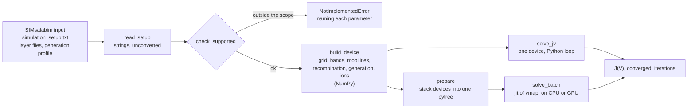
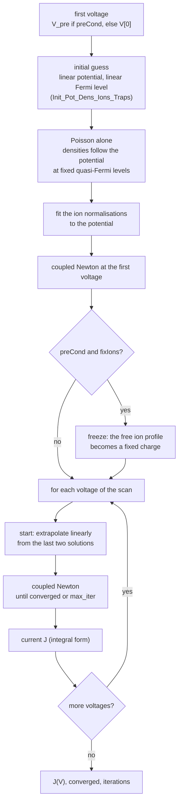
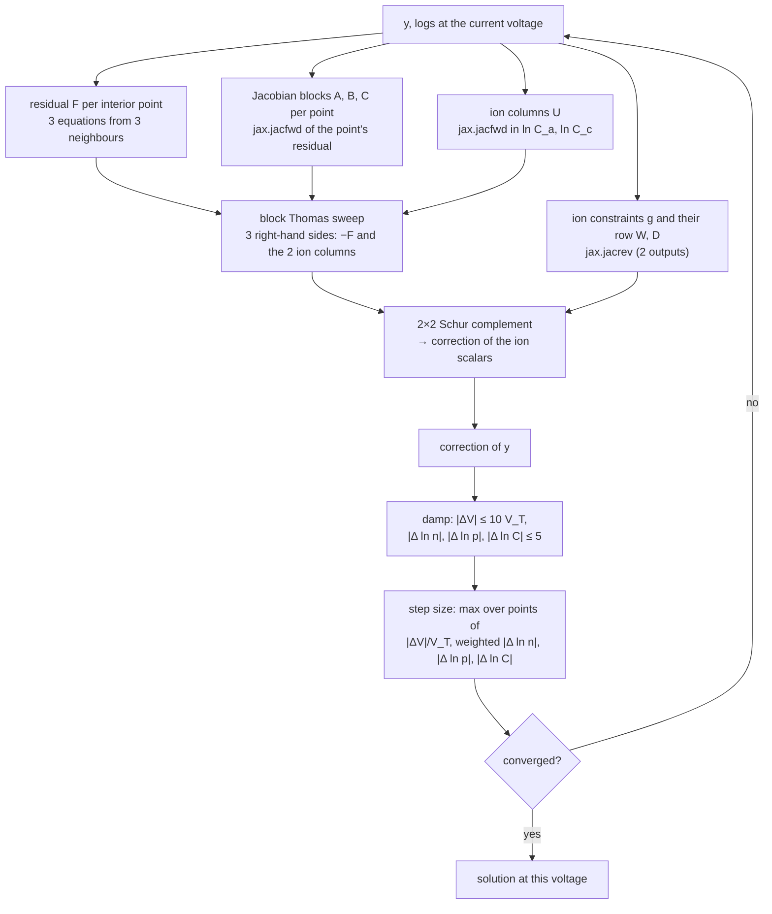

# How a J-V curve is solved

This page follows one device from its input files to its J-V curve: the data flow, the sequence
of solves, the Newton step and the linear solver. The batched solver ([batching.md](batching.md))
runs exactly this, for every device of a batch at once.

## From files to curves



Everything up to `build_device` is plain NumPy and happens once per device. From there on the
device is a set of static arrays (the stencil coefficients of [model.md](model.md), its
recombination and generation, its ions), and the solver only reads them.

## The unknowns

At each interior grid point `i = 1 … NP`, three unknowns:

```
y[i] = ( V[i], ln n[i], ln p[i] )
```

plus two scalars for the ions, `ln C_a` and `ln C_c`, the logarithms of the Boltzmann
normalisations of free anions and cations ([model.md](model.md)). A species that is not free
(none, immobile, or frozen) keeps its scalar fixed by an identity row.

The logarithms keep the densities positive and put their 20 orders of magnitude into a range
where a Newton step is well scaled. The boundary values (`V`, `ln n`, `ln p` at both contacts)
are fixed by the work functions and the applied voltage.

## The sequence of solves for one device



As pseudocode (`batch._solve_one`, the one-device form of the batched solver):

```text
function solve_one(device, voltages):
    V_first  ← device.V_pre if device.pre_cond else voltages[0]
    y        ← initial_guess(device, V_first)          # linear V, linear Fermi level
    y        ← poisson_only(y, V_first)                 # Newton on V alone, n and p follow V
    logs     ← fit_ion_normalisations(y)                # each free species to its number
    y, logs, pre_ok ← newton(y, logs, V_first)
    if device.pre_cond and device.fix_ions:
        freeze_ions(y, logs)                            # profile → fixed charge, scalars held

    y_last, y_before ← y, y
    V_last, V_before ← V_first, V_first
    for V in voltages:                                  # lax.scan
        r     ← (V − V_last)/(V_last − V_before) if V_last ≠ V_before else 0
        guess ← y_last + r · (y_last − y_before)        # the ion scalars alike
        y_new, logs, ok, steps ← newton(guess, logs, V)
        J[V]         ← terminal_current(y_new, V)
        converged[V] ← ok and pre_ok
        y_before, y_last ← y_last, y_new
        V_before, V_last ← V_last, V
    return J, converged, steps
```

**Why a Poisson-only start.** The linear initial guess is far from the solution in a device with
doped layers or ions. A few Newton steps on Poisson's equation alone, with `n ∝ exp(V/V_T)` and
`p ∝ exp(−V/V_T)` following the potential (SimSS's `Solve_Poisson` does the same), bring the
potential close before the coupled system starts; it is a scalar tridiagonal solve per step.

**Why extrapolate.** Along a J-V curve the solution changes smoothly with the voltage. Starting
each voltage from the linear extrapolation of the last two solutions (SIMsalabim's
`Extrapolate_Solution`) instead of from the last one saves Newton steps at every voltage;
together with the quadratic stop below it took the average from 4.6 to 2.8 steps per voltage
on the benchmark devices. The first voltage after a pre-bias starts from the pre-bias solution as it is; it is
usually the hardest voltage of a curve.

## The Newton step

One step solves the linearised system for a correction of every unknown at once.



### The residual, one point at a time

`solver._row` computes the three residuals of point `i` (Poisson, electron continuity, hole
continuity) from `y` at `i − 1`, `i`, `i + 1` and the two ion scalars. Each row is scaled by the
size of its terms (Poisson by `1/(q·N_c)`, continuity by `1/(μ_max·V_T·N_c·h)`), which keeps the
3×3 blocks well conditioned. `jax.vmap` over the points gives the whole residual `F`.

### The Jacobian by automatic differentiation

The derivative of `_row` with respect to its three neighbour arguments, `jax.jacfwd(_row,
argnums=(0, 1, 2))`, is exactly the row's three 3×3 blocks of the block-tridiagonal Jacobian:
`A[i]` (in `y[i−1]`), `B[i]` (in `y[i]`), `C[i]` (in `y[i+1]`). There are no hand-derived
Scharfetter–Gummel derivatives, the error-prone part of every drift-diffusion code, and no
dense Jacobian of the device (1200×1200, 11.5 MB per device) is ever formed: three forward
passes per point instead.

The ion scalars enter every Poisson row of their layer: `jax.jacfwd` in `ln C_a`, `ln C_c` gives
two extra columns `U` (NP × 3 × 2). The two constraints, "each free species holds its number of
ions", depend on the potential at every point of its layer; their derivatives (two rows `W` and
a 2×2 corner `D`) come from `jax.jacrev`, two reverse passes for two outputs. (Forward mode
there would take `NP` passes; it once cost 90 % of a Newton step.)

### The bordered system

With free ions the system is block tridiagonal, bordered by two rows and two columns:

```
| J   U | | δy |   | −F |        J: block tridiagonal (A, B, C)
| Wᵀ  D | | δl | = | −g |        U, W: NP×3×2, D: 2×2
```

It is solved by the Sherman–Morrison–Woodbury identity on top of one block sweep:

```text
[X_F | X_U] ← J⁻¹ · [ −F | U ]              # one sweep, three right-hand sides
S           ← D − Wᵀ·X_U                     # 2×2 Schur complement
δl          ← S⁻¹ · (−g − Wᵀ·X_F)
δy          ← X_F − X_U · δl
```

Without free ions `U` is zero, `D` the identity, and this reduces to `δy = J⁻¹·(−F)`. The same
code runs either way, which matters for a batch that mixes devices with and without ions.

### The block Thomas sweep

`solver._block_thomas` solves `A[i]·x[i−1] + B[i]·x[i] + C[i]·x[i+1] = d[i]` by Gaussian
elimination along the grid, the 3×3 blocks in place of numbers:

```text
forward,  i = 1 … NP:                       # lax.scan
    M     ← B[i] − A[i]·C'[i−1]
    C'[i] ← M⁻¹ · C[i]
    d'[i] ← M⁻¹ · (d[i] − A[i]·d'[i−1])
backward, i = NP … 1:                       # lax.scan, reverse
    x[i]  ← d'[i] − C'[i]·x[i+1]
```

Two details make it fast on a GPU, where the 2 × NP sequential steps otherwise each launch their
own small kernels: the 3×3 inverse is written out by the adjugate (elementwise arithmetic,
no batched LU call), and the 3×3 products as multiply-and-sum (no GEMM call per product), so
XLA fuses each step into one kernel; the scan is unrolled by 8, so eight grid points share a
kernel. Parallel cyclic reduction (log₂ NP fully parallel levels instead of a sequential sweep)
and a hybrid of both were built and measured: slower on every machine and batch size, because
each level passes over every block of every device and becomes bandwidth-bound. They were taken
out.

### Damping

A full Newton step far from the solution can overshoot by many `V_T`. Each component of the step
is clipped per point: the potential to ±10 `V_T`, the logarithms of the densities and of the ion
normalisations to ±5 (a factor e⁵). This is SIMsalabim's limit on the potential update
(`maxDelV`), applied to all three unknowns. Near the solution the clips are inactive and Newton
converges quadratically.

## When is a voltage converged?

The step size is the largest of `|ΔV|/V_T`, `|Δ ln n|` and `|Δ ln p|` (each weighted by
`dens/(dens + 1e-12·max N_c)`, so that densities far below anything that matters, whose
logarithms are pure round-off, do not count), and `|Δ ln C|`. A voltage is converged when any of
these holds:

| Criterion | Test | In |
|---|---|---|
| step below tolerance | step < `tol` (1e-10) | both solvers |
| round-off floor | the last four steps all below 1e-6, and none of the last three below a tenth of the first: the step has stopped falling | both solvers |
| quadratic stop | step < 1e-5 and below 1e-2 of the one before: in the quadratic regime the remaining error is about the step squared (1e-10), so the step that would only confirm it is not taken | `solve_batch` unless `strict` |
| settled current | step < 1e-3 and the terminal current unchanged to 1e-5 of the current scale over the last four steps | `solve_batch` unless `strict` |

The first two are what the one-device `solve_jv` uses. The last two are the batched solver's
shortcuts: together they save about a quarter of the Newton steps. Checked against `strict=True`
on some 2000 devices of a perovskite parameter table and the ion cases, they change `J` by at most 1.8e-6 of
the generation current, in the median by 2e-10 (`validation/shortcuts.py`).

The settled current is what a J-V curve needs where the potential cannot converge further:
frozen ions at high density leave a carrier-free bulk in which the potential keeps a few 1e-5
`V_T` of round-off noise; the current has settled long before.

A voltage that reaches `max_iter` without any of these is returned as it is, **flagged**
`converged = False`. jaxdd never stops early silently, and it never drops a voltage.
