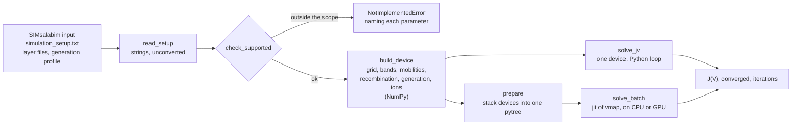
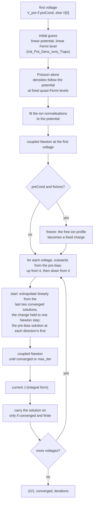
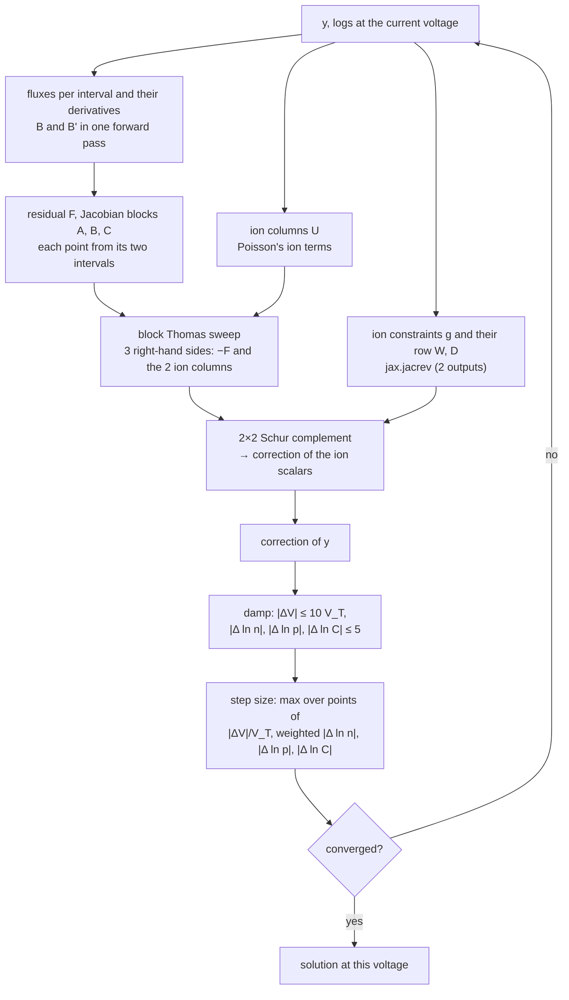

# How a J-V curve is solved

This page follows one device from its input files to its J-V curve: the data flow, the sequence
of solves, the Newton step and the linear solver. The batched solver ([batching.md](batching.md))
runs exactly this, for every device of a batch at once.

## From files to curves



Everything up to `build_device` is plain NumPy and happens once per device. From there on the
device is a set of static arrays (the stencil coefficients of [model.md](model.md), its
recombination and generation, its ions), and the solver only reads them.

## The unknowns

At each interior grid point `i = 1 … NP`, three unknowns:

```
y[i] = ( V[i], ln n[i], ln p[i] )
```

plus two scalars for the ions, `ln C_a` and `ln C_c`, the logarithms of the Boltzmann
normalisations of free anions and cations ([model.md](model.md)). A species that is not free
(none, immobile, or frozen) keeps its scalar fixed by an identity row.

The logarithms keep the densities positive and put their 20 orders of magnitude into a range
where a Newton step is well scaled. The boundary values (`V`, `ln n`, `ln p` at both contacts)
are fixed by the work functions and the applied voltage.

## The sequence of solves for one device



As pseudocode (`batch._solve_one`, the one-device form of the batched solver; `solve_batch`
sorts the voltages and returns the results in the caller's order):

```text
function solve_one(device, voltages):                   # voltages ascending
    V_first  ← device.V_pre if device.pre_cond else voltages[0]
    y        ← initial_guess(device, V_first)          # linear V, linear Fermi level
    y        ← poisson_only(y, V_first)                 # Newton on V alone, n and p follow V
    logs     ← fit_ion_normalisations(y)                # each free species to its number
    y, logs, pre_ok ← newton(y, logs, V_first)
    if device.pre_cond and device.fix_ions:
        freeze_ions(y, logs)                            # profile → fixed charge, scalars held

    up   ← [V in voltages if V ≥ V_first]               # ascending
    down ← [V in voltages if V < V_first], descending
    for V in up + down:                                 # one lax.scan, permuted per device
        if V is down[0]:                                # turn: back to the pre-bias
            y_last, y_before, V_last, V_before ← y, y, V_first, V_first
        r     ← (V − V_last)/(V_last − V_before) if V_last ≠ V_before else 0
        guess ← y_last + clip(r · (y_last − y_before), ±caps)   # the ion scalars alike
        y_new, logs_new, ok, steps ← newton(guess, logs, V)
        J[V]         ← terminal_current(y_new, V)
        converged[V] ← ok and pre_ok
        if ok and y_new, logs_new finite:               # jnp.where, per lane
            y_before, y_last ← y_last, y_new
            V_before, V_last ← V_last, V
            logs ← logs_new
    return J, converged, steps
```

**Why a Poisson-only start.** The linear initial guess is far from the solution in a device with
doped layers or ions. A few Newton steps on Poisson's equation alone, with `n ∝ exp(V/V_T)` and
`p ∝ exp(−V/V_T)` following the potential (SimSS's `Solve_Poisson` does the same), bring the
potential close before the coupled system starts; it is a scalar tridiagonal solve per step.

**Why extrapolate.** Along a J-V curve the solution changes smoothly with the voltage. Starting
each voltage from the linear extrapolation of the last two solutions (SIMsalabim's
`Extrapolate_Solution`) instead of from the last one saves Newton steps at every voltage;
together with the quadratic stop below it took the average from 4.6 to 2.8 steps per voltage
on the benchmark devices. The first voltage of each direction starts from the pre-bias solution
as it is. The one-device `solve_jv` scans the voltages in the order given, from the pre-bias to
the first, and starts each voltage from the last converged solution, without extrapolating.

**Why outwards from the pre-bias.** With the ions frozen (or free, or none) the steady state at
a voltage does not depend on the way there, so the scan may take the voltages in any order. A
scan from the lowest voltage up starts with a jump from `V_pre` to it, 1.25 V with ions frozen
at flat band (`V_pre` at `V_bi`, the scan from −0.2 V); on 16 384 devices of a parameter grid with
ions that first voltage took 11.5 Newton steps on average and up to 28, and 11 454 of the devices
took 10 or more there. Under `vmap` every device pays the slowest one's steps at every voltage
([batching.md](batching.md)), so that one voltage set the first pass's limit. Outwards from
`V_pre`, each direction's first voltage is at most one voltage step away: on the same devices it
takes at most 4 steps, and no voltage takes more than 12 (9 devices take 10 or more, above
0.7 V; with the Jacobian assembled by intervals, [below](#the-residual-and-the-jacobian-by-intervals)).
The curves agree with the upward scan's to 8e-6 of the generation current, within the
settled-current stop.

**Why the extrapolated change is clipped.** Convergence weighs out a density far below anything
that matters (`n_floor`, [below](#when-is-a-voltage-converged)): its logarithm does not enter
the test, so Newton stops with it wherever round-off left it. That logarithm is undetermined.
In the dark, in a thick device with a thick doped transport layer, the electrons in that layer
and the holes across much of the absorber lie at such densities (1e-30 m⁻³ and below), and
between two neighbouring converged voltages their logarithms differ by 30–100 at single points.
Extrapolated linearly, that difference became the start of the next voltage, e^100 off; Newton's
capped steps did not bring it back, the state became NaN, and the scan carried the NaN through
every later voltage. The first such difference is left at a voltage reached by a long way from
the pre-bias: it is declared converged while densities below the floor still move (40 more
Newton steps there move `ln p` at hundreds of points, at one by 29). The leftover is largest
where that way is longest: ions frozen at flat band, a pre-bias at `V_bi`, 1.25 V from −0.2 V
(the scan from the lowest voltage up; the scan outwards from the pre-bias shortens it to one
voltage step).
Whether a scan then failed was a matter of timing (of when the densities above the floor
converge), not of a threshold in any one parameter. So the extrapolated change of every unknown at every point is held to the
caps of one Newton step (`solver.STEP_CAPS`: 10 `V_T`, 5 in `ln n` and `ln p`; 5 in the ion
logarithms, the [damping](#damping) below). Where the solution moves smoothly the change is far
inside the caps and the start is the plain extrapolation: on the benchmark devices and on 1000
devices of a perovskite parameter table, light and dark, the curves are bit for bit those of
the unclipped start. On the device that showed it (`tests/data/frozen_thick_htl_dark`), 55 of
61 voltages failed in 3402 Newton steps; clipped, all 61 converge in 193.

**Why only a converged solution is carried on.** A voltage that fails (`max_iter`, or a state
that is not finite) does not become the start of the next: the scan keeps its last converged
solution and voltage, so the next voltage extrapolates from the last two converged ones (and
`solve_jv` starts from the last converged one). A failed voltage costs that voltage, not the rest
of the curve.

## The Newton step

One step solves the linearised system for a correction of every unknown at once.



### The residual and the Jacobian, by intervals

Each point has three residuals: Poisson, electron continuity, hole continuity. Poisson's
involves only the point and its neighbours' potentials. A continuity residual is the
difference of the Scharfetter–Gummel fluxes through the point's two intervals, plus generation
less recombination at the point:

```text
Fn[e] = μn[e]·V_T·( B(x)·n[e+1] − B(−x)·n[e] ),   x = (Vgn[e+1] − Vgn[e]) / V_T
Fp[e] = μp[e]·V_T·( B(x)·p[e] − B(−x)·p[e+1] ),   x = (Vgp[e+1] − Vgp[e]) / V_T
elec[i] = h[i−1]·Fn[i] − h[i]·Fn[i−1] + fac[i]·(G − R)[i]       (holes alike, signs turned)
```

A flux depends only on the six unknowns at its interval's ends. `solver._assemble` computes
every interval's fluxes and their derivatives once (`B` and `B'` in one forward pass,
`jax.jvp`, for the exact `B` as for SimSS's piecewise one), and each point takes its two
intervals': the residual `F` and the three 3×3 blocks of the block-tridiagonal Jacobian, `A[i]`
(in `y[i−1]`), `B[i]` (in `y[i]`), `C[i]` (in `y[i+1]`). Recombination's derivatives come from
`jax.jvp` as well. Each row is scaled by the size of its terms (Poisson by `1/(q·N_c)`,
continuity by `1/(μ_max·V_T·N_c·h)`), which keeps the blocks well conditioned. No dense
Jacobian of the device (1200×1200, 11.5 MB per device) is ever formed.

The reference is `solver._row`, the three residuals of one point from its three neighbours as
SIMsalabim writes them, and `jax.jacfwd` of it in its three neighbour arguments: `_assemble`
equals it to 1e-11 (tests). It was the solver's assembly before; two things replaced it.

- **Speed.** The row form evaluated every flux twice, once from each neighbouring row, in each
  of its nine forward passes, and the residual a third time. By intervals, a Newton step of
  4096 devices on an RTX 4070 Ti SUPER takes 18 ms instead of 73 (the assembly 7 instead of
  61; `validation/breakdown.py`).
- **Round-off.** The row form sums `lo·n[i−1] + m·n[i] + up·n[i+1]`, with `m` holding both
  intervals' terms. Where frozen ions at high density leave a carrier-free bulk under a strong
  field, those terms are many orders larger than their sum, and the residual kept a round-off
  that Newton could not get below: the potential kept a few 1e-5 `V_T` of noise there, voltages
  converged only by the settled current or not at all (in the dark, above about 0.8 V). As a
  difference of the two intervals' fluxes the residual has no such floor: on the hardest
  devices known (1e18 cm⁻³ frozen at full accumulation, `L_diff/d` 0.2) Newton without
  shortcuts reaches its 1e-10 step at every voltage, in about 5 steps, where the row form
  stalled at a third to a half of the voltages.

The ion scalars enter every Poisson row of their layer, through the Boltzmann densities
`exp(ln C ± V/V_T)`: two extra columns `U` (NP × 3 × 2), assembled with the rest. The two constraints, "each free species holds its number of
ions", depend on the potential at every point of its layer; their derivatives (two rows `W` and
a 2×2 corner `D`) come from `jax.jacrev`, two reverse passes for two outputs. (Forward mode
there would take `NP` passes; it once cost 90 % of a Newton step.)

### The bordered system

With free ions the system is block tridiagonal, bordered by two rows and two columns:

```
| J   U | | δy |   | −F |        J: block tridiagonal (A, B, C)
| Wᵀ  D | | δl | = | −g |        U, W: NP×3×2, D: 2×2
```

It is solved by the Sherman–Morrison–Woodbury identity on top of one block sweep:

```text
[X_F | X_U] ← J⁻¹ · [ −F | U ]              # one sweep, three right-hand sides
S           ← D − Wᵀ·X_U                     # 2×2 Schur complement
δl          ← S⁻¹ · (−g − Wᵀ·X_F)
δy          ← X_F − X_U · δl
```

Without free ions `U` is zero, `D` the identity, and this reduces to `δy = J⁻¹·(−F)`. The same
code runs either way, which matters for a batch that mixes devices with and without ions.

### The block Thomas sweep

`solver._block_thomas` solves `A[i]·x[i−1] + B[i]·x[i] + C[i]·x[i+1] = d[i]` by Gaussian
elimination along the grid, the 3×3 blocks in place of numbers:

```text
forward,  i = 1 … NP:                       # lax.scan
    M     ← B[i] − A[i]·C'[i−1]
    C'[i] ← M⁻¹ · C[i]
    d'[i] ← M⁻¹ · (d[i] − A[i]·d'[i−1])
backward, i = NP … 1:                       # lax.scan, reverse
    x[i]  ← d'[i] − C'[i]·x[i+1]
```

Two details make it fast on a GPU, where the 2 × NP sequential steps otherwise each launch their
own small kernels: the 3×3 inverse is written out by the adjugate (elementwise arithmetic,
no batched LU call), and the 3×3 products as multiply-and-sum (no GEMM call per product), so
XLA fuses each step into one kernel; the scan is unrolled by 8, so eight grid points share a
kernel. Parallel cyclic reduction (log₂ NP fully parallel levels instead of a sequential sweep)
and a hybrid of both were built and measured: slower on every machine and batch size, because
each level passes over every block of every device and becomes bandwidth-bound. They were taken
out.

### Damping

A full Newton step far from the solution can overshoot by many `V_T`. Each component of the step
is clipped per point: the potential to ±10 `V_T`, the logarithms of the densities and of the ion
normalisations to ±5 (a factor e⁵). This is SIMsalabim's limit on the potential update
(`maxDelV`), applied to all three unknowns. Near the solution the clips are inactive and Newton
converges quadratically. The same caps (`solver.STEP_CAPS`, `ION_LOG_CAP`) hold the batched
scan's extrapolated start.

## When is a voltage converged?

The step size is the largest of `|ΔV|/V_T`, `|Δ ln n|` and `|Δ ln p|` (each weighted by
`dens/(dens + 1e-12·max N_c)`, so that densities far below anything that matters, whose
logarithms are pure round-off, do not count), and `|Δ ln C|`. A voltage is converged when any of
these holds:

| Criterion | Test | In |
|---|---|---|
| step below tolerance | step < `tol` (1e-10) | both solvers |
| round-off floor | the last four steps all below 1e-6, and none of the last three below a tenth of the first: the step has stopped falling | both solvers |
| quadratic stop | step < 1e-5 and below 1e-2 of the one before: in the quadratic regime the remaining error is about the step squared (1e-10), so the step that would only confirm it is not taken | `solve_batch` unless `strict` |
| settled current | step < 1e-3 and the terminal current unchanged to 1e-5 of the current scale over the last four steps | `solve_batch` unless `strict` |

The first two are what the one-device `solve_jv` uses. The last two are the batched solver's
shortcuts: together they save about a quarter of the Newton steps (2.60 per voltage instead
of 3.51). Checked against `strict=True` on 2014 devices of a perovskite parameter table and the
ion cases, they change `J` by at most 1.2e-10 of the generation current, in the median by 4e-12
(`validation/shortcuts.py`).

The settled current stops a voltage whose current no longer changes while the potential's last
digits still do. With the row form of the residual it was what let the carrier-free bulk of
strong frozen charge converge at all ([above](#the-residual-and-the-jacobian-by-intervals));
assembled by intervals, every known device converges to `tol` without it, and it is a shortcut
like the quadratic stop.

A voltage that reaches `max_iter` without any of these is returned as it is, **flagged**
`converged = False`. jaxdd never stops early silently, and it never drops a voltage. The next
voltage starts from the last converged solution
([above](#the-sequence-of-solves-for-one-device)).
