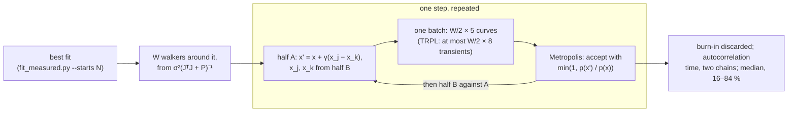

# Tutorial: from a SimSS input to J-V curves

## Install

```bash
pip install "jaxdd @ git+https://github.com/trn84/jaxdd@v0.5.0"            # CPU
pip install "jaxdd[cuda12] @ git+https://github.com/trn84/jaxdd@v0.5.0"    # an NVIDIA GPU
python -c "import jax, jaxdd; print(jaxdd.__version__, jax.devices())"
```

or, for the tests and the scripts of `validation/` (the examples below read the devices of
`tests/data/`), from a clone:

```bash
git clone https://github.com/trn84/jaxdd.git && cd jaxdd
python -m venv .venv && .venv/bin/pip install -e ".[dev]"     # ".[dev,cuda12]" on an NVIDIA GPU
.venv/bin/python -m pytest -q
```

jaxdd needs Python ≥ 3.11, JAX ≥ 0.4.31 and NumPy ≥ 1.26; `jaxdd.fit` needs SciPy too (the
extra `fit`). It switches JAX to 64-bit floats when it is imported. With a CUDA jaxlib
installed, JAX uses the GPU by default; `JAX_PLATFORMS=cpu` forces the CPU. What the `jaxdd`
package offers at its top level (`jaxdd.solve_batch`, …) is what this tutorial uses; the
modules (`jaxdd.device`, `jaxdd.batch`, …) hold the rest.

## One device

A device is described by SIMsalabim's files: `simulation_setup.txt`, one parameter file per
layer (`l1`, `l2`, ... in the setup), and the generation profile it names. The repository has
four such devices under `tests/data/`.

```python
import numpy as np

from jaxdd import build_device, check_supported, read_setup, solve_jv

setup = read_setup("tests/data/thin_l1_light/simulation_setup.txt")
check_supported(setup)              # NotImplementedError naming anything outside the scope
dev = build_device(setup)           # the graded grid and every static array (NumPy)

V = np.round(np.arange(-0.2, 1.3 + 1e-9, 0.025), 6)   # or simss_voltages(setup), SimSS's own
res = solve_jv(dev, V)
res.J            # A/m², SIMsalabim's sign: the photocurrent is negative
res.converged    # per voltage
res.iterations   # Newton steps per voltage
```

`read_setup` finds the layer files and the generation profile relative to the setup file.
`simss_voltages(setup)` gives the voltages SimSS would run, in its order (`Vmin` to `Vmax` by
`Vstep` or logarithmically towards `Vacc`, up or down, or `expJV`'s with `useExpData`).
`solve_jv` solves them in the order given, each from the solution at the one before. The
device's `G_frac` sets the light; `solve_jv(dev, V, g_frac=0.0)` gives its dark curve. With
`preCond = 1` the device is first settled at `Vpre` with its ions free (with `fixIons = 1` they
are then held for the scan; `fixIons = 1` alone holds them at each layer's starting density); a
pre-bias that does not converge raises `RuntimeError`.

`solve_jv` is the reference implementation, a Python loop easy to step through, about 20 curves
per second on one CPU core. For many devices use the batch.

## A film without contacts: photoluminescence

`W_L = free` or `W_R = free` (either, or both) ends the device at a surface instead of an
electrode ([model.md](model.md#free-surfaces-jaxdds-w_l-or-w_r--free)). That end's `S_n_*`, `S_p_*` are
the surface's recombination velocities (m/s, ≥ 0). `solve_state` gives one steady state and
what photoluminescence measures of it:

```python
from jaxdd import build_device, read_setup, solve_state

dev = build_device(read_setup("glass_absorber_etl/simulation_setup.txt"))  # W_L = W_R = free
r = solve_state(dev)              # the light of the device's G_frac; g_frac= to change it
r.qfls          # eV per point, V_T·ln(n·p/n_i²)
r.implied_voc   # V, the splitting direct recombination's emission sees
r.plqy          # ∫k·(n·p − n_i²) / ∫G: all direct recombination radiative, every photon out
r.n, r.p, r.V   # the profiles (V in its gauge: only differences mean something)
r.anion, r.cation  # the ions, mobile and fixed
```

With one contact, the voltage given only shifts the potential; with none it is not used.
`solve_state` works for any device, contacts at both ends too.

For many films, `solve_states` does the same for a batch, beside contacted devices if you like.
It is differentiable in the parameters of `device_tree`'s devices, so a fit to measured PLQY or
implied `V_oc` takes its gradient as a J-V fit does:

```python
from jaxdd import prepare, solve_states

r = solve_states(prepare([dev_a, dev_b]))      # one voltage, 0 V: all a free film needs
r["implied_voc"][:, 0], r["plqy"][:, 0]        # per device
r["qfls"][:, 0]                                # batch × NP + 2, eV
```

## Many devices

```python
from jaxdd import prepare, solve_batch

cases = ["thin_l1_light", "frozen_1e17_x1_thin_light", "steady_1e17_thin_light"]
devices = [build_device(read_setup(f"tests/data/{c}/simulation_setup.txt")) for c in cases]

batch = prepare(devices)            # every array stacked along a new first axis
J, converged, iterations = solve_batch(batch, V)     # each: devices × voltages
```

The voltages are the internal ones. With a shunt resistance `J` includes its current; with a
series resistance the external voltage of each point is `jaxdd.external_voltages(batch, V, J)`
(SimSS's external circuit, [model.md](model.md)).

The devices of one batch may differ in everything but the number of grid points `NP` (and they
share the voltages). `prepare` refuses a mix of grid sizes; group devices by `NP` and solve each
group as its own batch.

The first call compiles (seconds on a CPU, up to a minute on a GPU at large batches), and
again for every new **shape or option**: batch size, `NP`, number of voltages, `max_iter`,
`first_max_iter`, `bernoulli_name`, `strict`. For a long sweep cut the devices into batches of
one size (pad the last by repeating a device) and keep the options fixed; then only the second
pass compiles again, once per power of two of stragglers.

### Options

| Argument | Default | Meaning |
|---|---|---|
| `tol` | 1e-10 | the Newton step (potential in `V_T`, densities relatively) at which a voltage is converged |
| `max_iter` | 60 | Newton steps per voltage at most; a voltage that reaches it is flagged, not dropped |
| `first_max_iter` | 6 | the first pass's limit: devices with a voltage that misses it are solved again, together, with `max_iter` ([batching.md](batching.md)); `None` for one pass, and one pass always inside `jax.jit`, `jax.jvp` or `jax.vmap` |
| `bernoulli_name` | `"exact"` | `"simss"` reproduces SimSS's series approximation of the Bernoulli function ([differences.md](differences.md) §2) |
| `strict` | `False` | `True` turns off the two shortcuts (the quadratic stop and the settled current, [solver.md](solver.md)), for checking them; about one Newton step more per voltage |

### Inside JAX transformations

`solve_batch` runs inside `jax.jit`, `jax.vmap`, `jax.jvp` and `jax.grad`, in one pass there
(the second pass's shape depends on how many devices the first leaves). The curves are
differentiable in every array of the batch and in the voltages, in forward and reverse mode. The
derivatives are those of the converged solution, by implicit differentiation
([solver.md](solver.md#derivatives)); they agree with finite differences (tests):

```python
def curves(g):                                   # J(V) at a share g of the generation
    return solve_batch(dict(batch, g_frac=batch["g_frac"] * g), V)[0]

J, dJ_dg = jax.jvp(curves, (1.0,), (1.0,))      # forward mode
```

A voltage not converged has zero derivatives.

To differentiate in the input's own parameters — a layer's mobility, thickness, band edge, trap
or ion density, the temperature, a work function — build the device in JAX from them.
`device_parameters` splits an input into its **structure** (points per layer, which layers
generate, hold traps or ions, the pre-bias sequence) and its **parameters** (a dict: each of
`device.LAYER_PARAMETERS`, `device.ION_SITE_PARAMETERS`, `device.AUGER_PARAMETERS` and
`device.OPTICS_PARAMETERS` an array over the layers, and `T`, `W_L`, `W_R`, `G_frac`, `V_pre`,
the generation profile `gen_x`, `gen_G`, and with trap files their levels, `bulk_trap_E`,
`bulk_trap_N`, `int_trap_E`, `int_trap_N`, layers × levels, and `bulk_trap_Cn`, `bulk_trap_Cp`,
`int_trap_Cn`, `int_trap_Cp` where a file gives its levels their own capture coefficients); `device_tree` makes the batch's arrays from both, by
`build_device`'s formulas in `jax.numpy`:

```python
from jaxdd import device_parameters, device_tree

structure, params = device_parameters(setup)

def misfit(log_mu):                               # a curve against a measured one
    mu_n = jnp.asarray(params["mu_n"]).at[1].set(jnp.exp(log_mu))   # the absorber's
    p = dict(params, mu_n=mu_n)
    batch = jax.tree_util.tree_map(lambda v: v[None], device_tree(structure, p))
    J, ok, _ = solve_batch(batch, V)
    return jnp.sum(jnp.where(ok[0], J[0] - J_measured, scale) ** 2)   # see below

grad = jax.grad(misfit)(jnp.log(1e-3))            # reverse mode
```

In a fit, do not leave out a voltage that did not converge: a zero residual there rewards the
optimiser for leaving the region where the solver converges (a recombination coefficient run to
infinity, every voltage unconverged, the misfit zero). Give it a residual of the curve's scale
instead. `validation/fit.py` is a whole fit (least squares, the Jacobian by `jax.jacfwd`),
`validation/fit_measured.py` one of measured curves at five intensities at once,
`validation/sample_measured.py` its posterior; [validation.md](validation.md) shows what such
curves determine.

Devices of one structure batch by `jax.vmap(functools.partial(device_tree, structure))` over
stacked parameters, built on the GPU. A parameter change keeps the structure: the points per
layer stay those of the input's thicknesses (a thickness moves the grid, not its counts), and a
trap or ion density set on a layer that has none does nothing. The generation profile from a file
is stretched to the device as SimSS does, so a thickness moves it with the grid; it is not
recomputed optically.

### Reading the result

Every voltage of every device carries its `converged` flag; nothing is cut off silently. A
device whose pre-bias did not converge is flagged at every voltage. Mask by the flag before
using the curves (for a table, a fit or a training set). The `iterations` show where a batch
spends its time ([batching.md](batching.md)).

### A posterior by sampling

`validation/sample_measured.py` (and `validation/trpl_sample.py` for the TRPL decays) samples
the posterior of a fit's parameters: the prior uniform in the fitted coordinates (logarithms
where the fit takes them) within the bounds, the likelihood Gaussian per point with σ the best
fit's rms misfit. The walkers start around the best fit, drawn from the linearised posterior.
Each step moves the two halves of the walkers in turn, each by differential evolution relative
to the other (ter Braak 2006: along the difference of two walkers of the other half, scaled by
2.38/√(2d), by one in a tenth of the moves), so a step is two calls of the batched model
(`trpl_sample.py` solves only the proposals within the bounds; the others are rejected unsolved):



The move is invariant under affine maps of the parameters, so the Jacobian's singular values
over seven to nine decades cost it nothing where the posterior is close to Gaussian.

**Reading a parameter's histogram.** A walker stays where its proposal is rejected and counts
again, so each parameter set is visited in proportion to its posterior probability,
`exp(−Σr²/2σ²)` within the bounds: a set that fits a little worse is visited far less often,
since the sum runs over hundreds of points. The histogram of one parameter is every sample
projected on its axis, whatever the others are; a value is frequent where many combinations of
the others fit with it, so the peak need not be the best fit's value. A narrow peak is a
parameter the data determine; a flat histogram one they do not (the prior shows through); one
piled against a bound one the bound holds, where the data would go further. The widths scale
with σ, and with a systematic misfit they are a lower bound ([validation.md](validation.md)).

## A table over parameters

A table of curves over several parameters, interpolated between its points, needs each axis's
points dense enough for the curvature along it. `jaxdd.axes` chooses them by the
interpolation's own error instead of by hand:

```python
import numpy as np
from jaxdd.axes import in_chunks, interpolate, refine_axes

def curves(points):                 # (N, 2) parameter points -> (N, voltages)
    batch = devices_at(points)      # your devices at these points, as one batch
    J, converged, _ = solve_batch(batch, V)
    return np.where(converged, J, np.nan)

start = [np.geomspace(1e21, 4e24, 5), np.linspace(0.0, 1.0, 5)]    # coarse axes
r = refine_axes(in_chunks(curves, 512), start, tol=5e-2, log=[True, False], max_size=100_000)
r.axes, r.values                    # the refined axes and the table on them
J = interpolate(r.axes, r.values, np.array([[3e23, 0.4]]), log=[True, False])
```

`evaluate` (here `curves`) is any function from an `(N, d)` array of points to an `(N, ...)`
array of results, NaN where it has none; `in_chunks` calls it with one batch size, so the
solver compiles once. `tol` is in the results' unit, and `log` says which axes are refined and
interpolated in their logarithm.

Each round solves the table's new points as one call, estimates in every cell and for every
output how far the multilinear interpolation misses (the sum over the axes of `h²/8·|f''|`,
`f''` from the table's second differences along that axis), and where the sum exceeds `tol`
inserts the midpoint of the axis that misses most there. The axes only grow, so every point
solved is one of the final table's. The result says how it ended:

| Field | Meaning |
|---|---|
| `estimate` | the table's estimated error, the largest sum in one cell for one output |
| `error` | per axis its largest miss alone |
| `stopped` | `"converged"`, `"max_rounds"` or `"max_size"` (the next round's table would have been larger) |
| `unresolved` | per axis the intervals that should still have been split (`min_width`, `max_points`, or the stop) |
| `nan` | the table's points with a NaN result, left out of the estimate |

Two limits. The start must resolve every feature at least once: a peak between its points
leaves no curvature in the table and is never found. And the table stays a tensor product: a
feature that lies across the axes, or moves along an axis with the voltage of a curve stored
whole, crosses most intervals of the axis and needs the points everywhere. On such a table the
refinement saves the points an axis does not need, not more
([validation.md](validation.md#a-table-with-refined-axes)).

### A sparse grid

For such a feature `jaxdd.sparse` places the points one by one instead, where the interpolation
misses, on no tensor product:

```python
from jaxdd.sparse import interpolate_sparse, refine_sparse

ranges = [(1e21, 4e24), (0.0, 1.0)]
g = refine_sparse(in_chunks(curves, 512), ranges, tol=3e-2, log=[True, False])
g.points, g.values                  # the points solved and their curves
J = interpolate_sparse(g, np.array([[3e23, 0.4]]))
```

The interpolant is a sum of piecewise multilinear hats, each grid point's as wide as its level
along each axis; a point's surplus is what its value adds to the interpolant of the points
before it. Where it is above `tol` the point's children (the points of the next level beside it
along each axis) are added, with every ancestor they need, and each round solves its new points
as one call. It starts from five points per axis, as `refine_axes` usually does, and has the same
first limit: it cannot find a feature its start misses. Its `estimate` is the largest surplus of
the last points added; the error between the points was up to 1.4 times `tol`, so a table for
an error of 5e-2 takes a `tol` of 3e-2. On the perovskite cell's table of
[validation.md](validation.md#a-table-with-refined-axes) that is 10 858 points where the refined
axes took 50 274.

## Transients

ZimT's runs take the same devices through its time steps: a `tVGFile` named by the setup
(`t`, `Vext` or `oc` for the open circuit, `G_frac`, `Track`), read by `read_tvg`, and solved
for a batch by `solve_transient`:

```python
from jaxdd import read_tvg, solve_transient, tj_columns

setup = read_setup("tests/data/zimt_tpv_light/simulation_setup.txt")   # a photovoltage
tvg = read_tvg(setup)
r = solve_transient(prepare([build_device(setup)]), tvg)
r.V_ext[0]       # V per step: here the open-circuit voltage through a pulse of light
r.J_ext[0]       # A/m² per step, ZimT's Jext; J, V_int the internal ones
r.converged[0]   # per step
r.accepted[0]    # the steps ZimT writes (not one it skips, nor one after its automatic stop)
columns = tj_columns(r, 0)   # the rest of ZimT's tJFile, by ZimT's column names
```

One `TVG` serves every device of the batch, or a list gives each its own (all of one length).
Each step is one Newton solve by implicit Euler, from the step before, to `tol` within
`max_iter` (200); `bernoulli_name="simss"` as for the steady state. The integral current
(`currDiffInt = 2`) sums each density's change over its point's control volume, which is the
current the equations balance; ZimT's own sum, which converges slowly in the grid, with
`zimt_current=True` ([differences.md](differences.md) §13), for a comparison with ZimT. Where any device of a
batch has mobile ions, the whole batch takes the 5×5 blocks of the ions in time, and where any
has an open circuit or a series resistance, the internal voltage is an unknown of every
device's steps: batch such devices apart from the others where speed matters
([hardware.md](hardware.md), "Transients"). A transient is differentiable in the batch in
forward mode (`jax.jvp`, `jax.jacfwd`; `validation/fit_transient.py` fits one); inside a
transformation give `ions` and `vint` explicitly. It is not split across GPUs. What jaxdd
reproduces of ZimT, and what not, is in [model.md](model.md) "Transients".

### Going on from a state

A program that owns the time loop — one that ages devices and measures them between the steps —
continues a transient where the last one left the devices, ions and trapped charge included:

```python
first = solve_transient(batch, tvg_soak)                     # e.g. an hour at MPP bias
scan = solve_transient(batch, tvg_scan, initial=first.final)   # every time of tvg_scan after it
r = solve_transient(batch, tvg, profiles=True)
r.state(10)                                                  # step 10's state, from the profiles
```

`final` (always) and `state(k)` (with `profiles=True`) are `TransientState`s: the potential, the
densities and the ions on every point, the traps' occupations, the internal voltage and the
time, batch first. Split at any step and continued so, a transient is the unsplit one within the
Newton tolerance ([model.md](model.md#going-on-from-a-state-jaxdds)).

### Band diagrams in time, and photon recycling

A photoluminescence decay of a film without contacts is a transient like any other: a free film
(`W_L = W_R = free`), a `tVGFile` with the light on for the pulse and off after it. Two options
of `solve_transient` belong to such decays.

`profiles=True` keeps each step's state on every point, from which the band diagram at any
moment follows (SIMsalabim's convention: energies in eV below the vacuum level, a single `N_c`
for both bands):

```python
import numpy as np

setup = read_setup("film/simulation_setup.txt")   # W_L = W_R = free, a pulse in its tVGFile
dev = build_device(setup)
r = solve_transient(prepare([dev]), read_tvg(setup), profiles=True)
V, n, p = (r.profiles[k][0] for k in ("V", "n", "p"))   # steps × NP + 2; V in volts
E_c = -dev.E_c - V                                      # eV, per step and point
E_v = -dev.E_v - V
E_Fn = E_c + dev.Vt * np.log(n / dev.N_c)               # the quasi-Fermi levels
E_Fp = E_v - dev.Vt * np.log(p / dev.N_c)
```

Without a contact the potential's zero is a gauge: only differences mean something. A
carrier far below any density that moves a current (the holes in a doped transport layer, say)
has a quasi-Fermi level Newton does not resolve; leave it out of a plot.

`recycle=` reabsorbs the light of radiative recombination. In a film of high index most of it
cannot leave (97 % of a 600 nm perovskite's band-edge photons are absorbed again):
`recycling.device_kernel` gives the matrix of where each point's photons are absorbed, from the
absorber's optics (Fresnel at its faces, total reflection beyond the escape cones, the emission
spectrum from an absorption edge), and each step then adds them to the generation:

```python
from jaxdd.recycling import device_kernel

K, left, right = device_kernel(dev)       # NP × NP, and the shares leaving at either face
K[:, dev.k_direct[1:-1] > 0].sum(0)       # per emitting point, the share reabsorbed
r = solve_transient(prepare([dev]), read_tvg(setup), recycle=K)
```

The optics' defaults are a perovskite's (`n_slab` 2.6, glass below, air above, an Urbach edge
at 1.52 eV); `device_kernel(dev, n_slab=..., n_bottom=..., E=..., alpha=...)` takes others.
The kernel depends on the grid alone, so one serves every device of a batch on the same grid
(`recycle=K`), or a batch takes one per device (batch × NP × NP). How recycling is computed is
in [model.md](model.md#photon-recycling-jaxdds-in-time); on the TRPL of Kober-Czerny et al. it
slows the decays as a smaller `k_rad` would ([validation.md](validation.md#trpl-without-electrodes)).

## Impedance

The impedance at a voltage is one linear solve per frequency at the steady state there, not a
transient per frequency as with ZimT:

```python
import numpy as np
from jaxdd import solve_impedance

f = np.logspace(-2, 7, 91)                         # Hz
r = solve_impedance(prepare(devices), f, voltage=0.6)
r.Z            # Ω·m², devices × frequencies: with each device's series resistance and shunt
r.Y            # S/m², the internal admittance δJ/δV_int
r.capacitance  # F/m², Im(Y)/ω
```

Mobile ions follow the voltage at their own pace, and the traps' occupations, in the bulk and at the interfaces, at theirs.
`dt=` gives instead what `solve_transient` would measure with steps of `dt`, for a comparison
with a transient (a sine's response, ZimT's way). A free end is refused
([model.md](model.md), "Impedance").

## Building devices in code

`build_device` takes a `Setup`, which is the parsed files as strings. To vary parameters
without writing files, change the strings and build again; `validation/bench.py`
(`variant_setups`) does exactly this:

```python
from jaxdd import Layer, Setup

base = read_setup("tests/data/thin_l1_light/simulation_setup.txt")
layers = [dict(ly.raw) for ly in base.layers]
layers[1]["N_t_bulk"] = "3e21"                       # trap density of the absorber, m⁻³
variant = Setup(raw=dict(base.raw), layers=tuple(Layer(r) for r in layers),
                directory=base.directory)           # the generation profile is read from here
dev = build_device(variant)
```

Without any files, give `setup_from_texts` the texts by file name, under the names the setup
file uses (`l1`, `l2`, …, `genProfile`):

```python
from jaxdd import setup_from_texts

setup = setup_from_texts({
    "simulation_setup.txt": setup_text,
    "L1_parameters.txt": etl_text, "L2_parameters.txt": absorber_text,
    "L3_parameters.txt": htl_text,
    "generation_profile.txt": profile_text,
})
dev = build_device(setup)
```

Reading and building a device is NumPy work on the host, about 1.5 ms on one desktop core. For
very large sweeps build the next batch's devices in worker processes while the solver runs.

## Comparing with SimSS

jaxdd's grid is its own by default, graded towards every layer's ends: at 400 points it meets
the validation criteria on 99.6 % of hard devices where SimSS's grid meets them on 27 %
([validation.md](validation.md)), so its curves differ from SimSS's by SimSS's grid error (about
1e-3 of the current in the median there, up to a few percent). For a comparison point by point
take SimSS's grid:

```python
dev = build_device(setup, grid="simss")   # SIMsalabim's Make_Grid, as SimSS has it
```

`validation/compare_simss.py`, the benchmark against SimSS and the test suite do. To compare with
a SimSS run of the same input:

```bash
.venv/bin/python validation/compare_simss.py path/to/case_dir      # inputs + SimSS's JV.dat
```

Expect agreement to 1e-6 of the current scale with `bernoulli_name="simss"` and to a few 1e-4
with the exact Bernoulli function. Larger gaps are usually SimSS's: rerun SimSS with
`tolDens = tolPois = 1e-9` before suspecting jaxdd ([differences.md](differences.md),
[validation.md](validation.md)).

## Known limits

- **Strong frozen charge.** At 1e18 cm⁻³ of ions frozen at full accumulation (thin absorber,
  `L_diff/d` 0.2), the ions pile up in nanometre layers at 1500 times their mean density and
  leave a carrier-free bulk between them. jaxdd converges there at every voltage (its Jacobian
  assembled by intervals, [solver.md](solver.md)); SimSS skips a third of those voltages.
  Whether such a profile is physical is another question: Boltzmann's ions stack without limit
  unless bounded by their sites (`N_max_anion`, `N_max_cation`,
  [model.md](model.md#ions-bounded-by-their-sites-jaxdds-off-by-default)).
- **`fixIons` without `preCond`** holds the ions at SimSS's starting density, uniform in each
  layer, for the whole scan, which is rarely meant: with uniform ions of both signs at the same
  density they cancel, and the device behaves as one without ions.
- **One grid size per batch**; the graded grid is set before the solve from the layers'
  thicknesses, not adapted to the solution.
